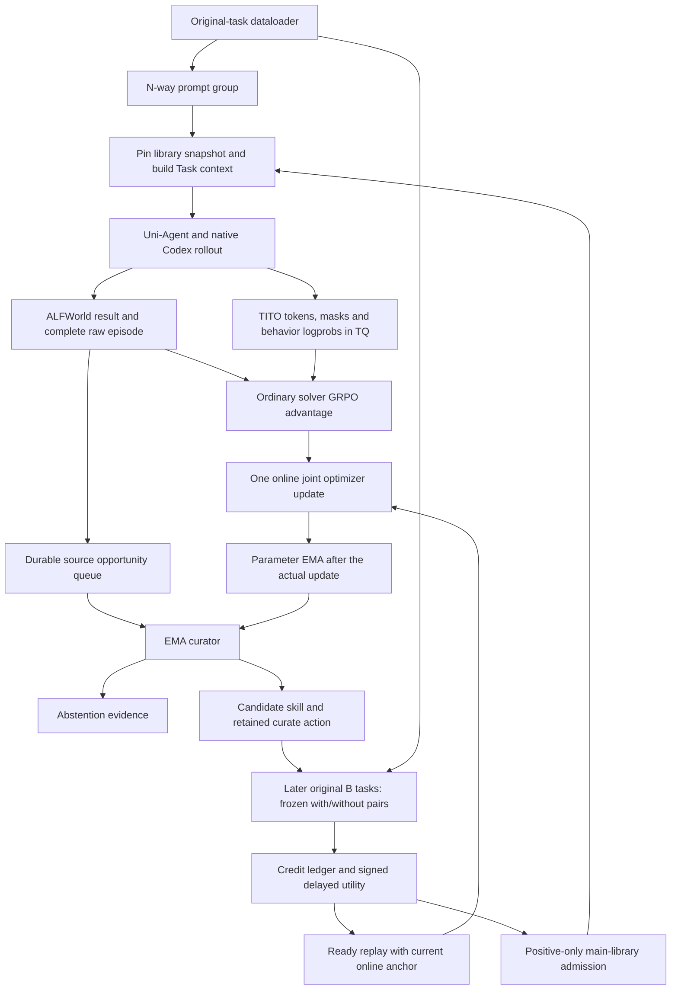

# Skill-based Self-Evolving Agent Training Harness

## Scope and implementation status

This document describes the implemented ALFWorld harness and its remaining
limitations. It is written against source cut
`6d2630b355fdb95f85861c8a43d0cc7dcd73ab89` on November 13, 2026. Operational
entrypoints evolved during experimentation; original manifests and later driver
receipts identify those transitions instead of pretending every run used the
same implementation. See [README.md](README.md) for launch commands.

The research question is whether an agent can improve both its parameters and a
persistent procedural memory: solve a task, extract a skill, test that skill on
later tasks, admit useful skills, and train the original extraction action from
its delayed utility. The target deliverable is an auditable training mechanism,
not merely a model that writes plausible summaries.

Implemented: original-task data preparation; persistent skill snapshots; host
injection; EMA curator; full accepted-episode review queue; explicit abstention;
paired delayed credit; durable action replay; role-specific joint loss; joint
checkpointing; and raw rollout evidence. Selected positive, negative and zero
credit examples have been observed and consumed by the learner.

Not established: matched final-test improvement, statistical significance of
individual skills, superiority of EMA over other teachers, or optimality of
the chosen reward coefficients. A dedicated structured ALFWorld action tool,
semantic skill merging and complete interrupted-work reconciliation remain
future work. Current solver interaction still passes through Native shell tools.

## 1. Benchmark and training data

### 1.1 Why ALFWorld

ALFWorld's text environment provides repeatable household tasks, observable
state transitions, admissible-command feedback and an authoritative success
flag. It supports procedural transfer while allowing programmatic checking.

| Supported task family | Shared procedure or prerequisite |
| --- | --- |
| `pick_and_place_simple` | Search, navigate, acquire, transport and verify placement |
| `pick_clean_then_place_in_recep` | Acquire an object before cleaning it at the appropriate fixture, then place it |
| `pick_heat_then_place_in_recep` | Acquire, use the heating operation/device, then place |
| `pick_cool_then_place_in_recep` | Acquire, use the cooling operation/device, then place |
| `look_at_obj_in_light` | Coordinate the target object and an enabled light source |
| `pick_two_obj_and_place` | Repeat acquisition/placement while tracking two distinct instances |

Different object names, receptacles and room layouts share subprocedures. A
useful skill describes object roles, state conditions and checks. It should not
memorize that a numbered object is in a particular drawer. State changes and
the final `won` flag provide stronger feedback than a model's success claim.

These families imply a gradient of procedural composition, not an experimentally
validated universal ordering of task difficulty. The current dataloader mixes
families with seeded shuffling; it does **not** implement an easy-to-hard
curriculum. Additional search difficulty and hidden object placement can make a
nominally simple family harder than a compound task.

### 1.2 Actual data construction

[`alfworld/data.py`](verl/experimental/skill_harness/alfworld/data.py) scans the
existing `json_2.1.1` files, retains the six supported families whose game metadata
marks them solvable, and validates companion files. It does not generate new
tasks or copy expert plans into prompts.

| Partition | Tasks | Scenes | Source and permitted use |
| --- | ---: | ---: | --- |
| Train | 3,154 | 97 | Original official train; optimization, curation and delayed-credit tasks |
| Dev | 399 | 11 | Whole scenes held out from original train; scheduled validation only |
| Official seen test | 140 | 76 | Original `valid_seen`, reserved for explicit testing |
| Official unseen test | 134 | 4 | Original `valid_unseen`, reserved for explicit testing |

The local eligible official training set has 3,553 tasks across 108 scenes.
With seed 42, scenes are sorted by a seeded hash and approximately 10% of scenes
(11) are held out. The resulting task fraction is not exactly 10%. Train and
dev share no scene IDs. The official seen/unseen labels are preserved from the
benchmark; holding additional scenes out of train does not redefine those labels.

Training family counts are 700 simple placement, 583 cleaning, 472 cooling,
417 heating, 260 light inspection and 722 two-object placement. These are counts
for the pinned local catalog, not a claim about every ALFWorld distribution.
Catalog digest:

```text
807ca811954c24bc78ae2b5d92ae0662dab163f5d6aedad0b859d873f11d9b0b
```

Each record contains `game_id`, original split, `task_type`, `scene_id`, a relative
game-file path and its SHA256. `game_id` depends on the relative path and file
content, so mount locations and scan order do not change task identity.
[`prepare_data.py`](verl/experimental/skill_harness/alfworld/prepare_data.py)
serializes original TaskConfig metadata into Parquet and writes the catalog,
partition membership and file hashes into `split_manifest.json`.

The initial dataset prompt describes the interaction protocol. The Task opens
the selected environment and supplies its actual initial observation and goal.
Generated actions, observations and rewards are collected online; no gold
trajectory is used as a solver answer. An important current retrieval limitation
is that its query can still be pinned from the generic dataset instruction before
that actual goal arrives; see the limitations section.

### 1.3 What A and B mean

**A** is an earlier original training episode from which the curator extracts a
candidate. **B** is a different original training task naturally encountered in
a later batch and selected for paired evaluation. They are not generated new
questions, a required two-turn dialogue, or two manually concatenated prompts.

For example, an A task involving a spatula can support an inspection procedure
that is tested on later kettle or soapbar tasks. Current eligibility requires a
different task ID and the same task family; two exposures must use two distinct
B tasks. It does not yet check the candidate's full semantic applicability.

We retain the ordinary dataloader. Persistent loading is a SkillStore/Task input
operation; it does not require the next dataloader batch to read the previous
batch's output files. A chain sampler would only be necessary if we explicitly
changed the data protocol to enforce task chains.

## 2. Policies, parameter sharing and EMA

| Role | Parameter source | Gradients / optimizer | Purpose |
| --- | --- | --- | --- |
| Online solver, theta | Trainable Qwen3.5-4B | One optimizer receives solver and curate losses | Solve tasks and learn which extraction actions are useful |
| Curator, phi | EMA of the online model | No independent backward or optimizer | Read completed source evidence; propose a skill or abstain |
| Frozen credit evaluator | Immutable starting checkpoint | No optimization | Supply a consistent reference for paired marginal utility |
| KL reference | Fixed reference policy in the ordinary actor/ref stack | No optimization | Regularize solver updates |

The local model name `Qwen3.5-4B-nothink` describes a template/configuration view
of the post-trained Qwen3.5-4B weights. It is not the raw Base checkpoint.
Non-thinking mode is an engineering choice; no on/off ablation establishes that
it is best for these tasks.

Initially phi equals theta. After each successfully observed online optimizer
step, [`ParameterEMA.update`](verl/experimental/skill_harness/ema.py) performs:

$$
\phi_{t+1}=0.95\phi_t+0.05\theta_{t+1}.
$$

This is an EMA of **parameters**, not rewards or advantages. Floating parameter
shadows are averaged; configured buffers are copied. An optimizer post-hook
counts actual steps, and the worker requires exactly one update per RPC. A
failed update cannot silently advance the EMA clock.

The curator inference route receives a published EMA snapshot only when no
curator generation is active. A long generation keeps its loaded version and
original behavior logprobs. Its observed weight version may therefore lag the
latest learner step. Version provenance is recorded from actual execution, not
inferred from the source task's step number.

The aim is a smoother extraction policy that follows what the shared online
model learns. This is a motivation, not an experimentally established benefit.
An appropriate ablation compares EMA, periodic hard copies and an online curator
under matched interaction and compute budgets.

## 3. Rewards and attribution

### 3.1 Two reward signals; KL is a regularizer

| Signal | Current definition | Receiver | Timing |
| --- | --- | --- | --- |
| Solver result | Environment success 1, observed normal failure 0 | Solver policy-gradient path | At episode scoring |
| Delayed skill utility | Mean paired difference on future B tasks | Original retained curate action | Once the credit window matures |
| Skill cost | Generated curate-token count multiplied by cost weight | Subtracted from skill utility | Settlement; weight is currently 0 |
| KL | Reference-policy regularization, coefficient 0.001 | Solver loss only | Online update; not an additional task reward |

There is no reward merely for writing a skill, no admission bonus, and no
independent format or retrieval-count reward. Current entropy coefficient is 0.
Malformed curator output and missing evaluations do not become invented zero
utility labels. An explicit abstention is retained as a neutral action record;
it currently has no direct utility label or replay loss.

### 3.2 Solver outcome and GRPO

For an eligible observed episode, the result score is:

$$
R_{\mathrm{task}}=\mathbf{1}[\mathrm{environment.won}].
$$

The environment is authoritative. A model saying “done” is not success.
The rollout limit is 50 environment actions; `look` and `inventory` count as
actions in the current interface. A declared 900-second budget failure can score0
only after its environment deadline, action ordering and owned-process/backend
closure have been verified. An unknown infrastructure outcome is not a task loss.

The solver retains verl's ordinary UID-grouped GRPO advantage and policy loss.
In the usual one-record-per-rollout case, the group-relative advantage has the
familiar form `(reward - group_mean) / (group_std + epsilon)`. It is applied
through the generated-response mask. Prompt and environment-output tokens remain
context rather than policy-gradient targets.

TITO prefixes can produce more learner rows than logical episodes. The code
preserves the adapter's UID grouping and standard loss semantics; do not infer
exact learner-row weighting from a plotted mean over unique episodes. Training
metrics and official benchmark coverage count logical episodes, not prefixes.

### 3.3 Delayed counterfactual utility

Let S be the candidate extracted from A. For a later eligible task B, the frozen
evaluator runs two branches:

$$
\Delta(B,S)=R_{\psi}(B;L\cup\{S\})-R_{\psi}(B;L),
$$

where L is the pinned baseline library and psi is the fixed evaluator policy.
Other skills, task identity, initial world, model, sampling protocol and relevant
input conditions are held fixed. We require the actual native first-input
comparison to show only the target skill difference, not merely two host strings
that appear similar.

The two branches use the same leased identity and controlled working directory,
with fresh distinct Native homes. They run sequentially within a pair; independent
pairs can run concurrently. The frozen policy uses the declared greedy reference
protocol. Fixed weights and seeds do not promise bitwise batch invariance for
the Qwen3.5 GDN backend.

For the two distinct future tasks in the current protocol:

$$
U(S)=\frac{\Delta(B_1,S)+\Delta(B_2,S)}{2}-c\,C(S),\qquad c=0.
$$

With binary scores, observed utility can be -1, -0.5, 0, 0.5 or 1. Positive
utility qualifies a candidate for the main library. Zero/negative utility
rejects main admission but can still produce a neutral/negative replay label.
For zero advantage the curate policy-gradient term is zero.

`required_exposures=2`, `min_delay_steps=2`, and `window_seconds=86400` are
declared protocol parameters. The delay is checked against the recorded window
opening step, which need not equal A's source step when background work lags.
At most 32 pairs are scheduled per update. Missing, interrupted and unobserved
exposures remain distinct from an observed difference of zero.

The measured quantity is utility under a **frozen reference solver and selected
future tasks**. It is not the exact long-run return of the evolving online solver.
Applicability selection, library interactions and small sample counts limit
causal generalization beyond each controlled pair.

### 3.4 Where the delayed reward is attached

1. A solver episode finishes and retains its original result reward.
2. The EMA curator receives its observed trajectory and emits a skill action.
3. Before TQ cleanup, persist the complete curator input, original generated
   token IDs, curate mask, processed behavior logprobs, policy version and skill
   reference in `CurateReplayRecord`.
4. Later paired results create immutable usage events linked to that record.
5. The ledger settles U(S) only when the declared evidence is sufficient.
6. The learner re-evaluates the **old curator context/action under current online
   parameters**, assigns U(S) as its external advantage, and updates the online
   model. This does not backpropagate through an old computation graph.

The delayed reward belongs to the extraction action. It does not overwrite A's
task reward or get broadcast across all of A's solver actions. The curator
replica receives the result indirectly through future parameter EMA updates.

### 3.5 Off-policy curate loss

For retained context x and complete generated curate action a, let M be the
authored-token mask. Let mu be the actual EMA behavior distribution recorded at
generation, pi_anchor the detached current-online evaluation immediately before
the update, and pi_theta the differentiable online policy during training.

Define complete-action log likelihoods by sums over M, not length averages:

$$
\ell_{\pi}(a\mid x)=\sum_{j\in M}\log\pi(a_j\mid x,a_{<j}).
$$

The implementation uses a detached historical weight and a proximal ratio:

$$
w=\min\{10,\exp(\ell_{\mathrm{anchor}}-\ell_{\mu})\},\qquad
r=\exp(\ell_{\theta}-\ell_{\mathrm{anchor}}).
$$

The current/anchor log ratio also has a numerical clamp to [-20,20]. With
epsilon=0.2 and the external advantage A_c=U(S):

$$
L_{\mathrm{curate}}=-\mathbb{E}\left[w\min\left(rA_c,
\operatorname{clip}(r,0.8,1.2)A_c\right)\right].
$$

This branch intentionally bypasses solver GRPO's within-group centering and
session-final advantage broadcast. With one candidate per source, centering
that singleton would erase the only utility signal. No learned value estimator
is required for this external marginal-utility baseline.

Only the original curate action tokens receive its loss; the full context is
retained. Role normalization is computed across the complete optimizer minibatch
and DP group before microbatch splitting. Curate and solver rows do not share
one indiscriminate token denominator.

The configured objective is:

$$
L=L_{\mathrm{solver\ GRPO}}+0.1L_{\mathrm{curate}}
  +0.001L_{\mathrm{solver\ KL}}.
$$

These are loss coefficients, not a guaranteed90/10 split of gradient magnitude.
The same learner and optimizer perform one joint step. Curator/evaluator workers
never independently step the online parameters.

Current replay limits are 32 ready records per update, at most 64 online updates
of lag relative to the observed curator version, and one permitted label update.
A replay lease and applied-update acknowledgement prevent ordinary duplicate
consumption. Ambiguous crash boundaries require reconciliation; this is not a
claim of database-style atomicity across optimizer tensors and filesystem state.

Important approximation limits:

- Capping and clipping introduce bias; sequence products can have high variance.
- Behavior support matters. Curator collection uses temperature 1 and full
  top-p/top-k support; missing behavior probabilities are not recomputed later.
- Action ratios do not correct all changes in source contexts, retrieval,
  downstream task selection, library contents or the live solver.
- The current curate learner accepts one complete TITO trajectory per candidate.
  Multi-segment candidates need a differentiable whole-action reduction and are
  not silently treated as independent tokenwise PPO samples.
- EMA slows parameter movement but does not itself solve off-policy attribution.

## 4. Skill representation, review and loading

### 4.1 What evolves

The online parameters and the persistent skill library evolve together. The
curator follows online parameters through EMA. The benchmark task pool and
frozen evaluator remain fixed under the declared experiment protocol.

A proposed skill has five model-authored fields:

```json
{
  "skill_id": "host-assigned-identity",
  "title": "A concise procedural title",
  "principle": "A reusable procedure with observed prerequisites and checks",
  "when_to_apply": "The relevant goal and state conditions",
  "task_families": ["pick_and_place_simple"]
}
```

The host assigns identity and provenance; the model must copy required identity
fields. Curator instructions prohibit invented locations, hidden state and
measured downstream benefits. A failure can support a useful caution but is not
evidence that a complete plan succeeded.

The alternate valid action is:

```json
{"decision":"abstain","reason":"The observed evidence does not support a reusable procedure."}
```

Abstention retains exact prompt/action tokens and old logprobs in its own durable
action record. It creates no SkillArtifact, counterfactual window or invented
zero-advantage replay row. A malformed response is a protocol rejection, not a
model abstention. The decision to abstain is not yet trained with its own reward.

### 4.2 Review coverage and persistent queue

The old prototype read one path-sorted source per step. The production background
profile now queues every completed logical episode in the accepted solver
minibatch. With 32 prompts and N4, this normally means 128 opportunities. Multiple
TITO fragments of one episode do not create duplicate opportunities.

The bounded FIFO source queue is saved in controller state. Its states are
`queued`, `running`, `generated`, `abstained`, `source_censored` and `failed`.
`sources_read` measures host source loading; `source_sampled` is separate evidence
that a model action was captured. Neither an enqueued record nor a host read
alone proves curator inference completed.

Source backlog is bounded at 16,384, curator concurrency at 8 and pending credit
windows at 8,192. Capacity limits defer dispatch; a queue-full condition is an
explicit error rather than silent source dropping. Sources with no environment
actions or over-capacity full context are explicitly censored before sampling.
The host does not truncate evidence to manufacture a valid curator input.

The declared host prompt budget reserves 4,096 tokens for Native additions and
2,048 tokens of output headroom within 36,864 capacity. The actual Gateway also
checks encoded input capacity. Syntactic validity does not prove skill quality.

### 4.3 Store, admission and retrieval

`SkillStore` persists immutable artifacts, candidate records, admission decisions,
snapshot manifests and branch heads. The prompt group is pinned to a snapshot
before N-way fanout, so its four sibling rollouts cannot observe different
library heads merely because background publication occurred between launches.

A candidate first enters an isolated evaluation branch. Its basic integrity
admission is **not** a claim that the main library accepted it. Main publication
requires settled utility strictly above the current threshold 0.

The current retriever is deterministic family-plus-lexical matching. It selects
whole skills with `top_k=6` and a 1,024-token skill budget, then checks the complete
rendered prompt budget. The host injects the selected content into the Task user
message. The model does not learn a retrieval-tool decision in this version.
Saved context manifests include snapshot/ref identities, content hashes, rendered
ranges and budget exclusions.

This approach controls the loading mechanism during experiments. It also leaves
retrieval quality outside the policy gradient. Current lexical queries and
family-only counterfactual eligibility are limited: inappropriate retrieval can
produce negative utility even when a narrow procedure is valid in another state.

There is no semantic deduplication, automatic skill rewrite, broad regression
admission suite or mature retirement policy yet. Equal content under different
skill identities/provenance can remain separate. A bounded prompt does not imply
a bounded or nonredundant library. These are explicit engineering/research gaps.

## 5. Rollout and learning dataflow



The source opportunity becomes durable at the online update boundary, before
the parent trainer clears its solver TQ batch. Background generations and paired
tests then progress independently. A learner step reads only credit that has
already matured; it does not wait for every current candidate to be evaluated.

The controller pins future B inputs when their real training batch is available.
The pair can execute later with those saved inputs. This is asynchronous reward
collection, not two independent optimizers racing on shared weights.

### Why stock rollout plumbing is insufficient

verl already supports multi-turn agents, tools, custom loops, reward functions
and distributed training. Calling its rollout universally stateless or
single-turn would be inaccurate. What the default path does not supply for this
experiment is the cross-episode skill state and its lifetime/credit contract:

| Missing contract | Why it matters |
| --- | --- |
| Persistent versioned skill memory | A later episode needs a stable view of skills from earlier episodes |
| Source-to-skill-to-consumer lineage | A useful later result must identify the original extraction action |
| Durable behavior trajectories beyond TQ cleanup | The delayed label arrives after ordinary learner rows are consumed |
| A declared counterfactual protocol | Retrieval/use count alone cannot establish incremental utility |
| A separate advantage/mask path for curate replay | Solver GRPO centering is not the intended curate objective |
| Coordinated online/EMA updates and joint restore | Model, library, replay and credit clocks must not restart independently |

We add these contracts through existing extension points rather than replacing
the complete trainer. Loading is performed by the host context builder, not by
teaching the dataloader to read generated skill files.

## 6. File-level changes and interfaces

The pre-harness repository baseline is
`517ddeff0b0ad77610f4f3925740f37d9156eee6`. The following map describes executable
changes through the documentation source cut; docs/tests accompany these files.

```bash
git diff --stat 517ddeff0b0ad77610f4f3925740f37d9156eee6..6d2630b355fdb95f85861c8a43d0cc7dcd73ab89
git diff --name-status 517ddeff0b0ad77610f4f3925740f37d9156eee6..6d2630b355fdb95f85861c8a43d0cc7dcd73ab89 -- verl examples/skill_self_evolve
```

### 6.1 Data, environment and agent boundary — added

| File under `verl/experimental/skill_harness/` | Interface / responsibility | Reward or learning purpose |
| --- | --- | --- |
| `alfworld/data.py`, `alfworld/prepare_data.py` | Stable GameRecord identities, grouped splits and Parquet TaskConfig rows | Prevent evaluation leakage and identify original A/B tasks |
| `alfworld/protocol.py` | Public state projection and initial message construction | Environment truth, not model self-assessment |
| `alfworld/server.py` | Baseline HTTP create/step/observe/close and ordered budget state | Authoritative task result and action order |
| `alfworld/task.py`, `alfworld/runner.py` | Registered Task lifecycle around the original Uni-Agent CodexAgent | Return result reward, raw finish/error metadata and artifact pointers |
| `alfworld/accounts.py`, `alfworld/native_files.py` | Private attempt identities, isolated processes, archive and closure | Prevent cross-episode contamination; preserve evidence |
| `alfworld/terminal_guard.py`, `alfworld/backend_terminal.py` | Observe terminal state, close admission, target the actual backend request, retain stopped tails | Separate environment completion from Native/model completion |
| `alfworld/budget.py` | Shared proof-based budget-outcome verifier | Admit a timeout zero only for a proven budget failure |
| `bootstrap.py`, `uniagent_compat.py` | Pin real imports and exact compatibility patch identity | Keep the recorded experiment executable on the intended stack |

The core Task retains the environment session capability outside model-authored
arguments. Each ordinary attempt leases one private identity. Paired branches
share a controlled pair identity/cwd but fresh Native homes. This isolation is
not a substitute for a narrow action interface: the current shell still permits
irrelevant commands, and the boundary does not claim general network isolation.

### 6.2 Persistent skills and delayed credit — added

| File | Interface / responsibility | Why it is needed |
| --- | --- | --- |
| `framework.py` | `SkillAwareRolloutAdapter.create`, framework context hooks, text-only admission | Reuse the official agent adapter while attaching stable skill context |
| `context.py` | `pin_prompt_group`, `enrich_task_messages`, `build_skill_context` | Snapshot consistency, retrieval and exact injected-input provenance |
| `store.py` | `SkillArtifact`, `SkillStore`, candidate branches and immutable snapshots | Generation, persistence, controlled admission and later loading |
| `source_queue.py` | Persistent source opportunities, FIFO claims and terminal dispositions | Review coverage without blocking solver updates |
| `curate.py` | `collect_curate_candidate` returns `CurateCollection` or `CurateAbstention` | Preserve actual EMA-authored action and distinguish abstention from error |
| `replay.py` | `CurateReplayRecord`, `ReplayRef`, immutable record storage | Retain full context/action/mask/old-mu beyond TQ lifetime |
| `probes.py` | `collect_counterfactual_probe`, branch verification and failure capture | Paired result reward and exact target-skill-only input control |
| `credit.py` | `CreditProtocol`, `UsageEvent`, `CreditSettlement`, `CreditLedger` | Signed utility, deduplication of events, leases and applied acknowledgements |
| `controller.py` | `prepare_update`, `after_update_and_sync`, background source/probe dispatch | Coordinate source lifetime, future task binding, admission and ready replay |

There is no separately shipped class named `CurateReplaySampler`. Its planned
responsibilities are implemented by ledger ready-label selection in the
controller and the replay-batch builder. Documenting the actual class boundary
avoids implying an unused alternative training pipeline.

### 6.3 Online loss, EMA and checkpoints — added

| File | Existing extension point / new interface | Purpose |
| --- | --- | --- |
| `replay_batch.py` | `prepare_curate_anchor_inputs`, `finalize_joint_batch` | Build role-separated rows, preserve original masks/mu, attach delayed advantage |
| `losses.py` | `skill_harness_loss` through the public Engine loss hook | Standard solver objective plus complete-action off-policy curate objective |
| `joint_worker.py` | Actor worker subclass and public `set_loss_fn` | Role normalization and one coordinated online backward/update |
| `ema.py`, `ema_worker.py` | ParameterEMA and actual optimizer-step post-hook | Parameter-only teacher evolution and exact update clocks |
| `policy_routes.py` | Dedicated EMA and frozen inference routes | Keep teacher publication and reference evaluation distinct from solver replicas |
| `trainer.py`, `joint_trainer.py` | V1 sync trainer subclass, train/checkpoint hooks | Prepare replay, acknowledge actual updates, run one persistent background loop |
| `joint_checkpoint.py` | COMPLETE manifests and checkpoint callback/coordinator | Bind parameters, optimizer, RNG, EMA, library, replay, ledger, queues and dataloader |
| `group_sampler.py` | Supported V1 custom ReplayBuffer constructor/refill hook | Reject incomplete invalid groups without turning missing siblings into reward 0 |
| `evaluation.py`, `validation_audit.py`, `telemetry.py` | Explicit evaluation stages, case reconciliation and metrics | Separate training examples from held-out claims |
| `train.py` | Public `run_ppo(..., task_runner_class=...)` entry | Select the custom workers and trainer without rewriting the RL engine |

### 6.4 Existing core file modified

[`verl/workers/rollout/vllm_rollout/vllm_async_server.py`](verl/workers/rollout/vllm_rollout/vllm_async_server.py)
contains the narrow targeted-abort repair. vLLM 0.24 randomizes internal request
IDs, so the code checks the unique external/internal mapping and calls the
public `engine.abort(request_id, internal=False)`. It does not clear a shared
prefix cache when stopping one episode. The acknowledgement explicitly means
abort submission; the owner still waits for the original generate future to
resolve before claiming backend drain.

Against the pre-harness baseline, the skill-harness modules are additions and
this is the tracked existing verl core-file modification. A local, unrelated
`transferqueue_utils.py` diagnostic edit on the experiment machine is not part
of this documented committed change set.

### 6.5 Operational extensions in `examples/skill_self_evolve/`

| Files | What changes |
| --- | --- |
| `config/alfworld_common.yaml`, `config/alfworld_joint.yaml` | Select agent adapter, actor worker/loss, EMA, loading, source/credit budgets and callbacks |
| `prompts/solver_system.md`, `prompts/solver_task.txt` | Native solver instructions and original task interaction contract |
| `prompts/curator_system.md`, `prompts/curator_task.txt` | Evidence-grounded skill or abstention output contract |
| `run_resilient.sh`, `scripts/launch_resilient.py`, `scripts/parallel_environment_launcher.py` | One-command preparation, checks, selected profile, supervision and resume |
| `scripts/parallel_environment_server.py` | Four sticky process shards and separate durable-I/O executor with per-request timing |
| `scripts/alfworld_request_client.py`, `scripts/train_parallel_client.py` | Action UUIDs, lookup/retry of the original result, and explicit profile assets |
| `scripts/train_resilient_setup.py` | Narrowly classify proven pre-Native setup failures and refill groups without fabricated rewards |
| `scripts/native_posix_spawn.py`, `scripts/native_posix_spawn.c`, `scripts/train_spawn_safe.py` | Preserve solver UID/kernel/ready-pipe behavior without threaded pre-exec fork stalls |
| `scripts/all_native_spawn.py`, `scripts/curator_posix_spawn.c`, `scripts/train_all_native_spawn.py` | Also handle the registered curator runuser launch shape; preserve actual loop/helper provenance |
| `scripts/direct_checkpoint_restore.py`, `scripts/train_direct_checkpoint.py` | Validate once, read immutable tensors directly and copy only mutable state; passive control-loop diagnostics |
| `scripts/train_quiescent_eval.py` | Quiesce background activity and seal the final policy/library before official tests |
| `scripts/compare_official_runs.py` | Offline matched comparison using original cases and actual restored/lifecycle bindings |

The parallel profile selects the all-role outer entry for both fresh and resumed
runs. These composed entries deliberately record their own file/helper hashes;
an unchanged core fingerprint does not mean the outer execution behavior was
unchanged. External Uni-Agent compatibility patches are separately pinned and
verified in its own source checkout; they are not hidden modifications to verl.

## 7. Runtime ordering, failures and restart

TextWorld's shared parser motivated serialized execution inside one process.
The newer service uses four independent processes, each owning its sessions and
executing one engine operation at a time. A session stays on one shard. Durable
I/O runs outside the HTTP event loop, while session locks preserve the ordering
of action execution, result persistence and acknowledgement.

Each action can carry a stable request ID. After a lost response, the client
queries the original result and reuses that ID rather than blindly repeating
the action. The registry is tied to one server instance; a service restart is
not permission to re-execute an uncertain action. The request-ID guarantee
applies to actions, not a general create/restart transaction protocol.

Termination kinds distinguish MDP terminal, budget timeout, task cancellation and
host error. The first bound stop is immutable. A host stop does not invent world
`done`, model EOS, a successful Native exit or a reward. Interrupted token tails
are archived with their actual values and are not passed off as normal generation.

Checkpointing gates shared store/replay/ledger commits briefly while capturing a
consistent cut. It does not need to wait for every model generation. The model,
optimizer, RNG, EMA and saved data cursor are bound to the same COMPLETE manifest.
Direct restore avoids repeatedly copying immutable large tensor files, but still
validates the selected checkpoint and creates distinct writable state roots.

Two restart limitations remain important:

1. Running background jobs in a restored cut are currently marked interrupted
   instead of fully reconciling all already saved post-cut generation/pair
   outputs. This can strand valid evidence or leave a window without its planned
   exposure. Never turn missing evidence into reward 0 to hide that gap.
2. Final evaluation freezes the admitted library by stopping background work.
   This ensures a stable test snapshot, but does not guarantee all queued sources
   were reviewed or all pending candidates evaluated before training ended.

The whole-run status, background queue state, actual optimizer clock, final model
version and evaluation completion are different facts and must be reported
separately.

## 8. Validation artifacts and observed examples

### 8.1 Evidence chain

A complete example should make these links inspectable:

```text
source episode A + environment result
  -> original EMA curator input/output + old behavior logprobs
  -> immutable skill candidate/version
  -> later B with/without inputs, worlds and full trajectories
  -> immutable usage events and utility settlement
  -> admission decision / main snapshot
  -> retained curate replay record and applied optimizer update
  -> an ordinary later rollout that actually loads the admitted skill
```

The last ordinary success is useful loading evidence, but if several skills are
present it does not isolate one skill's contribution. The paired experiment
provides the candidate-specific marginal score. Negative and zero examples are
necessary to show that generation or original task success is not itself the
admission reward.

### 8.2 Four preserved real cases

All four cases below come from
`alfworld_joint_full64_v9_20261112`, selected after observing outcomes. Full
original source/reuse groups, raw Native events, numerical TITO, evaluator
captures, artifacts, snapshots and ledger records were copied to a local evidence
bundle. A complete file-hash check covered 7,381 exported files and 40 episodes.
This is a trajectory evidence backup, not a model-weight backup.

| Candidate | Source A / EMA | Paired differences | Utility | Applied online update | Ordinary later loading |
| --- | --- | --- | ---: | ---: | --- |
| Disambiguate closed receptacles before open inspection | Clean a spatula and place it on a diningtable; EMA1 | Clean kettle: 1-0; clean soapbar: 0-0 | +0.5 | 5 | Step6: clean bowl and put in fridge; reward 1 |
| Retrieve object under lit desk lamp | Look at alarmclock under desklamp; EMA3 | Pencil: 1-0; bowl: 1-0 | +1 | 6 | Step7: look at pillow under desklamp; reward 1 |
| Navigate to cupboard, pick item, move to toilet | Put handtowel on toilet; EMA2 | Glassbottle to cabinet: 0-1; handtowel to garbagecan: 1-1 | -0.5 | 5 | Not admitted |
| Simple single-object transport | Put dishsponge on cart; EMA1 | Cellphone to armchair: 1-1; spraybottle to garbagecan: 1-1 | 0 | 5 | Not admitted |

The source result reward is1 for each listed A. Their differing later utilities
show why successful-source summarization alone is not a sufficient objective.
The negative case also exposes applicability mismatch: a toilet-specific note
was evaluated on another placement goal. Its score measures the current loading
protocol, not a universal judgment that the procedure is wrong everywhere.

Exact curator collection identities, relative to the run's `curate/` directory:

| Case | Collection ID |
| --- | --- |
| +0.5 | `0f80a2d26f6f4672b5d9c12306d0e4e125b268dece8422fe5bb0ea2ce5190036` |
| +1 | `53acb7ad4e9f5a55f6bd4ff9154d519ceeae68a4c3662a23934b9f48ccb9f560` |
| -0.5 | `298d1d3130981c71836f5dc4519066d5026636187213bd7cd0017cf8df09cc2c` |
| 0 | `f4452283b831b5a7c89aee64e5976331c369908a32f88f710fbdd7f9731eceb0` |

For each collection, `generated.json` retains the original output and
`complete.json` links the skill and replay record. Window IDs use `window_` plus
the collection ID; replay IDs use `curate-` plus the collection ID. Follow the
initialized driver receipt to the active ledger/store root after resume.
`credit_probes/*/paired-event.json` links the exact with/without episode paths;
the corresponding actual-input audit verifies the only-skill difference.

Solver/curator training probabilities are preserved. Some frozen-evaluator
captures have no response logprobs; these are not used as the original curate
behavior distribution and must not be filled in after the fact. TITO segments
remain separate because their prefixes can overlap. Raw host terminal stops
remain distinguishable from natural Native completion.

These examples demonstrate implemented generation/loading/credit consumption.
They do not measure isolated per-skill gradients, overall held-out gains or
statistical significance. At the documentation cut, v9 had reached 10 confirmed
updates and recorded a step 8 dev mean of approximately 0.7118. There is no matched
pre/post official-test conclusion from those observations. Training-batch scores
must not be compared directly with that dev score.

### 8.3 Verification layers

| Layer | Checks | What it does not establish |
| --- | --- | --- |
| Pure/CPU contracts | Source coverage, abstention, immutable references, reward arithmetic, masks, IS/clipping, role normalization, scheduling and restore rules | Actual model/world behavior |
| Real transport checks | Native stdio/UID/closure, exact backend cancellation, process-sharded environment and request-ID recovery | Learning or benchmark improvement |
| Real rollout evidence | Original actions, observations, authoritative rewards, token IDs/masks/logprobs and actual loaded skills | Population-level transfer benefit |
| Real learner evidence | Actual optimizer/EMA clocks, nonzero mixed curate loss, consumed replay labels and saved state | Optimal hyperparameters or an individual skill's isolated gradient |
| Held-out comparison | Complete matched official case sets, fixed inference protocol, sealed final library and untouched base | A parameter-only or memory-only causal decomposition |

## Limitations and next experiments

1. **Action interface.** The current general shell permits off-task tool loops.
   In step 5, 126 of 128 episodes finished by about 8m40s, while two zero-action
   episodes exhausted 900s each and extended rollout to 20m35s. One polled an
   unrelated installation; the other repeatedly generated wrong tool calls.
   A dedicated ALFWorld action tool and an explicitly versioned no-progress
   policy are proposed changes, not features to claim as already deployed.
2. **Skill abstraction and validation.** Generated text can overfit object names,
   invent mechanics or repeat generic instructions. Add structured preconditions,
   evidence references, content-level deduplication and applicability checks.
   Preserve negative evidence rather than presenting every candidate as useful.
3. **Retrieval query.** The current fallback can be the same generic instruction
   for different tasks. Build retrieval from the actual goal/public observation,
   while preserving identical context for GRPO siblings and strict CF controls.
4. **Delayed-credit throughput.** Two pairs per candidate and a 32-pair/update
   budget support at most about 16 newly completed candidates per update before
   runtime losses. Observed candidate production can be higher. Queue latency,
   expiry, stale replay and family coverage need explicit monitoring and budget
   allocation; not every generated skill can be assumed to receive a label.
5. **Recovery and final coverage.** Reconcile completed raw captures before
   abandoning interrupted jobs. Distinguish a stable final library seal from a
   fully drained review/evaluation queue. These goals require different logic.
6. **Off-policy bias.** Historical action ratios, caps and replay lag limits do
   not correct the whole evolving system. Compare different caps, lag windows,
   evaluator refresh policies and on-policy alternatives without changing the
   attribution claim silently.
7. **Reward sparsity.** Binary paired differences can be zero even when both
   branches fail or both succeed. Efficiency/state-progress shaping is a possible
   future objective, but is not part of the current reward. It needs safeguards
   against optimizing short trajectories that fail the real task.
8. **EMA and abstention learning.** Test EMA against direct/periodic copies.
   Abstention currently has no learned opportunity-cost objective. Learning when
   not to curate requires a separate declared reward design; assigning arbitrary
   zeros to skipped opportunities is insufficient.
9. **Evaluation attribution.** Compare no-skill and skill-enabled agents at
   matched parameter checkpoints, plus a fixed-policy memory-only condition.
   Use multiple seeds and report uncertainty. The current final-system comparison
   alone combines parameter changes and library growth.
10. **Operational cost.** Measure environment queueing, model decode, tool waits,
    checkpoint I/O and startup separately. Environment improvements do not cure
    a model's 900-second shell loop. Larger microbatches were not automatically
    faster in the measured long-sequence profile; tune from actual throughput.

## Related implementations

- [verl](https://github.com/verl-project/verl): distributed RL infrastructure and
  extension points reused here.
- [SkillRL](https://github.com/aiming-lab/SkillRL): useful comparison for host-side
  skill injection and direct ALFWorld environment workers. Its inspected
  `4d984d4` implementation gives each environment a Ray actor and extracts game
  actions from model text; it does not use our Native shell-to-HTTP route.
  Our learnable delayed-curate objective and EMA design are additional research
  choices, not evidence that our implementation is more mature.
- [ALFWorld](https://github.com/alfworld/alfworld): the original household-task
  benchmark and environment semantics used for programmatic results.

The intended contribution is a concrete, inspectable link from an old extraction
action to later measured reuse utility, within one coordinated learner. Its
success should ultimately be judged by reproducible held-out results and the
cost/reliability of collecting that evidence.
