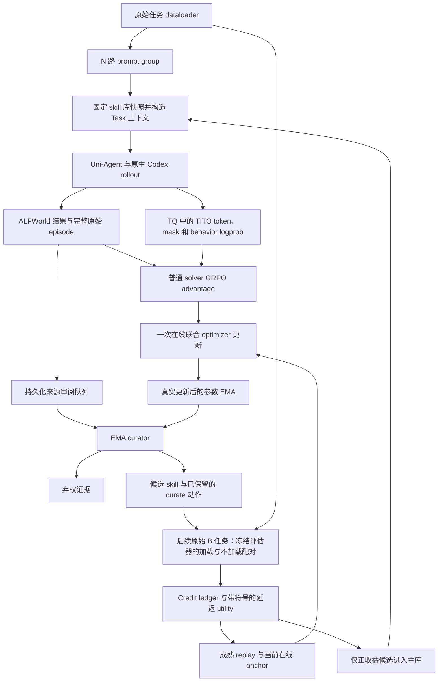

# 基于 Skill 的自进化 Agent 训练 Harness

[English](AAAA_Design_Idea.md) · 简体中文

## 范围与实现状态

本文描述已实现的 ALFWorld harness 及其局限，对应源码版本 `6d2630b355fdb95f85861c8a43d0cc7dcd73ab89`，记录日期为 2026 年 11 月 13 日。实验过程中运行入口有所演进；原始 manifest 和后续 driver 回执会标明这些变化，而不会将所有运行描述成使用了完全相同的实现。启动命令见 [README_CN.md](README_CN.md)。

本中文版本对应英文文档提交 `4c2c8bb5d703f25f128617c7de64aa1d5f5ff100`。

研究问题是：agent 能否同时改进模型参数和持久化的程序性记忆——解决任务、提炼 skill、在后续任务上测试 skill、接纳有用的 skill，再根据其延迟收益训练最初的提炼动作。目标是形成可审计的训练机制，而不只是让模型写出看似合理的总结。

已实现的部分包括：原始任务数据准备、持久化 skill 快照、宿主侧注入、EMA curator、覆盖全部合格 episode 的审阅队列、显式弃权、配对延迟 credit、持久化动作 replay、按角色区分的联合 loss、联合 checkpoint，以及原始 rollout 证据。已经观察到选定的正收益、负收益和零收益案例，并确认其标签被 learner 消费。

尚未确立的结论包括：匹配条件下的最终测试集提升、单个 skill 的统计显著性、EMA 相比其他 teacher 更新方式的优势，以及 reward 系数的最优性。专用的结构化 ALFWorld 动作工具、语义级 skill 合并和完整的中断任务核对恢复仍属于后续工作。当前 solver 仍通过 Native shell 工具与环境交互。

## 1. Benchmark 与训练数据

### 1.1 为什么选择 ALFWorld

ALFWorld 文本环境提供可重复运行的家庭任务、可观察的状态转移、允许动作反馈，以及权威的成功标记。它既支持操作流程的迁移，也便于程序化验证。

| 支持的任务族 | 可共享的流程或前置条件 |
| --- | --- |
| `pick_and_place_simple` | 搜索、移动、取得物体、搬运和确认放置结果 |
| `pick_clean_then_place_in_recep` | 先取得物体，再在适当设施处清洗，最后放置 |
| `pick_heat_then_place_in_recep` | 取得物体、使用加热操作／设备，再放置 |
| `pick_cool_then_place_in_recep` | 取得物体、使用冷却操作／设备，再放置 |
| `look_at_obj_in_light` | 协调目标物体与已开启的光源 |
| `pick_two_obj_and_place` | 重复执行取得／放置流程，并跟踪两个不同实例 |

不同物体名称、容器和房间布局共享部分操作流程。有用的 skill 应描述物体角色、状态条件和检查方式，而不是记住某个编号的物体位于某个抽屉。环境状态变化和最终 `won` 标记，比模型自称成功提供了更可靠的反馈。

这些任务族体现的是流程组合复杂度的梯度，不是已经通过实验验证的通用难度排序。当前 dataloader 采用固定随机种子的混合打乱采样，**没有**实现从易到难的课程学习。搜索难度和未知物体位置也可能让名义上简单的任务比复合任务更难。

### 1.2 实际的数据构造

[`alfworld/data.py`](verl/experimental/skill_harness/alfworld/data.py) 扫描现有 `json_2.1.1` 文件，保留六类支持的任务及游戏元数据中标记为可解的实例，并验证配套文件。它不生成新任务，也不把专家计划复制到模型输入。

| 数据部分 | 任务数 | 场景数 | 来源与允许用途 |
| --- | ---: | ---: | --- |
| Train | 3,154 | 97 | 原始官方 train；参数优化、curation 和延迟 credit 任务 |
| Dev | 399 | 11 | 从原始 train 中按完整场景留出；仅用于定期验证 |
| 官方 seen 测试 | 140 | 76 | 原始 `valid_seen`，保留用于显式测试 |
| 官方 unseen 测试 | 134 | 4 | 原始 `valid_unseen`，保留用于显式测试 |

本地满足筛选条件的官方训练部分包含 108 个场景、3,553 道任务。使用 seed 42，按带随机种子的哈希排序场景，留出约 10% 的场景，即 11 个场景。因此，留出的任务比例并不恰好等于 10%。Train 和 dev 不共享场景 ID。官方 seen／unseen 标签沿用 benchmark 原定义；额外从 train 留出场景，不会重新定义官方标签。

训练集各任务族数量为：简单取放 700、清洗 583、冷却 472、加热 417、灯下观察 260、双物体取放 722。这些数字对应固定的本地 catalog，并非对所有 ALFWorld 数据分布的概括。Catalog digest 为：

```text
807ca811954c24bc78ae2b5d92ae0662dab163f5d6aedad0b859d873f11d9b0b
```

每条记录包含 `game_id`、原始 split、`task_type`、`scene_id`、游戏文件相对路径及其 SHA256。`game_id` 由相对路径和文件内容决定，因此挂载位置和扫描顺序改变时，任务标识仍保持一致。[`prepare_data.py`](verl/experimental/skill_harness/alfworld/prepare_data.py) 将原始 TaskConfig 元数据序列化为 Parquet，并将 catalog、各数据部分的成员和文件哈希写入 `split_manifest.json`。

数据集中的初始 prompt 描述交互协议。Task 打开对应环境后，才提供真实的初始观察和目标。动作、观察和 reward 在线采集，不把标准轨迹作为 solver 的答案。当前检索存在一个重要局限：真实目标到达之前，query 可能已经由通用数据集指令固定下来，详见后面的局限部分。

### 1.3 A 和 B 分别是什么

**A** 是较早的一条原始训练 episode，curator 从中提炼候选 skill。**B** 是后续 batch 自然采样到、被选来做配对评估的另一道原始训练任务。它们不是新生成的题目，不要求构成固定的两轮对话，也不是人为拼接的两段 prompt。

例如，一道关于铲子的 A 任务可能提供检查流程，随后在关于水壶或肥皂的任务上测试。当前 B 的筛选条件是任务 ID 不同、任务族相同；两次 exposure 必须使用两个不同的 B。实现尚未检查候选完整的语义适用条件。

我们保留普通 dataloader。持久化 skill 的加载由 SkillStore／Task 输入构造完成，不需要下一批 dataloader 去读取上一批生成的输出文件。只有明确改变数据协议、强制组织任务链时，才需要链式 sampler。

## 2. 策略、参数共享与 EMA

| 角色 | 参数来源 | 梯度／optimizer | 用途 |
| --- | --- | --- | --- |
| 在线 solver，theta | 可训练的 Qwen3.5-4B | 一个 optimizer 接受 solver 和 curate loss | 解决任务，并学习哪些提炼动作有价值 |
| Curator，phi | 在线模型的 EMA | 没有独立 backward 或 optimizer | 阅读已完成的来源证据，提出 skill 或弃权 |
| 冻结 credit 评估器 | 不变的初始 checkpoint | 不参与优化 | 为配对边际收益提供一致参考 |
| KL reference | 普通 actor／ref 栈中的固定参考策略 | 不参与优化 | 对 solver 更新施加正则约束 |

本地模型名称 `Qwen3.5-4B-nothink` 表示后训练版本 Qwen3.5-4B 权重的模板／配置视图，并非原始 Base checkpoint。关闭 thinking 是工程选择；尚无开关对照实验能证明它最适合这些任务。

初始化时 phi 等于 theta。每次在线 optimizer 更新成功并被确认后，[`ParameterEMA.update`](verl/experimental/skill_harness/ema.py) 执行：

$$
\phi_{t+1}=0.95\phi_t+0.05\theta_{t+1}.
$$

这是对**模型参数**做 EMA，不是对 reward 或 advantage 做滑动平均。浮点参数的影子副本进行加权平均，配置中的 buffer 则直接复制。optimizer post-hook 统计真实更新次数，worker 要求每次 RPC 恰好发生一次更新。失败的更新不能悄悄推进 EMA 时钟。

只有没有 curator generation 正在执行时，才会向 curator 推理路由发布新的 EMA 快照。长时间运行的 generation 会保留其已加载版本和原始 behavior logprob，因此实际观察到的权重版本可能落后于最新 learner step。版本来源按真实执行记录，而不是由来源任务的 step 推断。

这种设计希望让提炼策略平滑地跟随共享在线模型的学习。这是设计动机，不是已经确立的实验优势。合适的消融应在匹配的交互和计算预算下，比较 EMA、周期性硬复制和直接使用在线参数的 curator。

## 3. Reward 与归因

### 3.1 两种奖励信号；KL 属于正则项

| 信号 | 当前定义 | 接收方 | 时间点 |
| --- | --- | --- | --- |
| Solver 结果 | 环境成功为 1，已观察到的正常失败为 0 | Solver policy-gradient 分支 | Episode 评分时 |
| 延迟 skill utility | 后续 B 任务上的配对差值均值 | 原始、已保留的 curate 动作 | Credit window 成熟后 |
| Skill 成本 | 生成的 curate token 数乘以成本系数 | 从 skill utility 中扣除 | 结算时；当前系数为 0 |
| KL | 相对参考策略的正则项，系数 0.001 | 仅作用于 solver loss | 在线更新时；不属于额外任务奖励 |

不会因为写出一个 skill 就发奖励，没有 admission bonus，也没有独立的格式奖励或检索次数奖励。当前熵系数为 0。格式错误的 curator 输出和缺失的评估结果，都不会被转换成虚构的零 utility 标签。显式弃权会保存为中性的动作记录，目前没有对应的直接 utility 标签或 replay loss。

### 3.2 Solver 结果与 GRPO

对满足评分条件、结果已被观察到的 episode：

$$
R_{\mathrm{task}}=\mathbf{1}[\mathrm{environment.won}].
$$

环境是权威来源，模型说“完成”不代表成功。Rollout 最多执行 50 个环境动作；当前接口中的 `look` 和 `inventory` 也计为动作。只有验证了环境截止时间、动作顺序和所属进程／后端请求的结束状态，声明的 900 秒预算耗尽才可以记为 reward 0。结果不明的基础设施异常不能当成任务失败。

solver 保留 verl 原有的、按 UID 分组的 GRPO advantage 和 policy loss。在常见的每条 rollout 对应一条 learner record 的情况下，组相对 advantage 形如 `(reward - group_mean) / (group_std + epsilon)`，通过生成 response 的掩码作用于模型。Prompt 和环境返回 token 保留为上下文，不作为 policy-gradient 目标。

TITO 前缀可能让 learner row 数量多于逻辑 episode 数量。代码保留 adapter 的 UID 分组和标准 loss 语义；不能从“按唯一 episode 统计的曲线均值”直接推断精确的 learner-row 权重。训练结果指标和官方 benchmark 覆盖率按逻辑 episode 计数，而不是按前缀计数。

### 3.3 延迟反事实 utility

设 S 是从 A 中提炼的候选。对后续满足条件的任务 B，冻结评估器分别运行两条分支：

$$
\Delta(B,S)=R_{\psi}(B;L\cup\{S\})-R_{\psi}(B;L),
$$

其中 L 是固定的基线 skill 库，psi 是固定的评估策略。其他 skill、任务标识、初始世界、模型、采样协议和相关输入条件保持一致。要求实际 Native 首次输入的对照结果表明：差别只有目标 skill，而不只是两份看起来相似的宿主字符串。

一对评估的两条分支共享租用身份和受控工作目录，但使用不同的全新 Native home。同一对内两条分支顺序运行，不同 pair 可以并发。冻结策略采用声明的 greedy 参考协议；固定权重和 seed 并不意味着 Qwen3.5 GDN 后端在不同运行 batch 下保证逐 bit 一致。

当前协议对两个不同的后续任务计算：

$$
U(S)=\frac{\Delta(B_1,S)+\Delta(B_2,S)}{2}-c\,C(S),\qquad c=0.
$$

在二元结果分数下，已观察到的 utility 可能为 -1、-0.5、0、0.5 或 1。正 utility 才能使候选进入主库。零或负 utility 会阻止主库接纳，但仍可生成中性／负向 replay 标签。Advantage 为零时，curate policy-gradient 项为零。

`required_exposures=2`、`min_delay_steps=2` 和 `window_seconds=86400` 是声明的协议参数。延迟依据持久记录的 window 开启 step 检查；后台处理滞后时，这个 step 不一定等于来源 A 的 step。每次更新最多调度 32 个 pair。缺失、中断和未观测的 exposure，与“已观察到差值为零”始终分开记录。

这里衡量的是**冻结参考 solver 在选定后续任务上的 utility**，不是持续变化的在线 solver 的精确长期回报。适用性筛选、skill 库之间的相互影响，以及样本量较小，都会限制配对实验结论向其他场景推广。

### 3.4 延迟奖励具体附着到哪里

1. Solver episode A 结束，保留其原始任务结果 reward。
2. EMA curator 接收该 episode 的已观察轨迹，生成 skill 动作。
3. 在 TQ 清理之前，将完整 curator 输入、原始生成 token ID、curate mask、processed behavior logprob、策略版本及 skill 引用持久写入 `CurateReplayRecord`。
4. 后续配对结果创建不可变 usage event，并关联回这条记录。
5. 只有声明的证据足够时，ledger 才结算 U(S)。
6. Learner 在当前在线参数下重新计算**旧 curator 上下文／动作**，将 U(S) 作为外部 advantage 更新在线模型；不是穿过旧计算图进行反向传播。

延迟奖励属于提炼动作，不会覆盖 A 的任务 reward，也不会广播到 A 的所有 solver 动作上。Curator 副本通过后续参数 EMA 间接吸收更新。

### 3.5 Off-policy curate loss

对已保留的上下文 x 和完整 curate 动作 a，设 M 为模型实际生成 token 的掩码。mu 是生成时实际记录的 EMA behavior 分布，pi_anchor 是紧邻更新前、停止梯度的当前在线策略评估，pi_theta 是训练过程中可求梯度的在线策略。

完整动作的 log likelihood 对 M 中的 token 求和，不做长度平均：

$$
\ell_{\pi}(a\mid x)=\sum_{j\in M}\log\pi(a_j\mid x,a_{<j}).
$$

实现采用停止梯度的历史权重和近端比值：

$$
w=\min\{10,\exp(\ell_{\mathrm{anchor}}-\ell_{\mu})\},\qquad
r=\exp(\ell_{\theta}-\ell_{\mathrm{anchor}}).
$$

当前策略与 anchor 的 log ratio 还会在数值上限制到 [-20,20]。取 epsilon=0.2，外部 advantage 为 A_c=U(S)：

$$
L_{\mathrm{curate}}=-\mathbb{E}\left[w\min\left(rA_c,
\operatorname{clip}(r,0.8,1.2)A_c\right)\right].
$$

这个分支有意绕过 solver GRPO 的组内中心化和 session 终局 advantage 广播。每条来源只有一个候选时，若对这个单元素组中心化，就会抹掉唯一的 utility 信号。对于这种外部边际 utility 基线，不需要额外训练 value estimator。

只有原始 curate 动作 token 接收该 loss，完整上下文仍然保留。角色归一化在 microbatch 切分之前，按完整 optimizer minibatch 和 DP group 计算；curate 与 solver row 不共用一个不区分角色的 token 分母。

当前目标函数为：

$$
L=L_{\mathrm{solver\ GRPO}}+0.1L_{\mathrm{curate}}
  +0.001L_{\mathrm{solver\ KL}}.
$$

这些是 loss 系数，不保证实际梯度大小按 90／10 分配。同一个 learner、同一个 optimizer 执行一次联合更新；curator 和评估器 worker 不会独立更新在线参数。

当前 replay 限制为：每次更新最多使用 32 条成熟记录，相对于实际观察到的 curator 版本，最多滞后 64 次在线更新；每个标签最多应用一次。Replay lease 和 applied-update 确认可以防止常规的重复消费。崩溃边界不明确时仍需核对恢复，不能据此声称 optimizer tensor 与文件系统状态具备数据库式原子性。

这些近似的边界包括：

- 权重上限和 clipping 会引入偏差；整段序列概率乘积可能有较高方差。
- Behavior 的采样支持范围很重要。Curator 使用 temperature 1、覆盖完整支持范围的 top-p／top-k 采样；缺失的 behavior 概率不能在事后重算填补。
- 动作概率比不能修正来源上下文、检索、后续任务选择、skill 库内容和在线 solver 的全部变化。
- 当前 curate learner 要求每个候选对应一条完整 TITO trajectory。跨多个片段的候选需要可微的整段动作归约，不能悄悄当成独立的 tokenwise PPO 样本。
- EMA 可以减缓参数变化，但本身并不解决 off-policy 归因问题。

## 4. Skill 表达、审阅与加载

### 4.1 什么在进化

在线参数和持久化 skill 库共同演化，curator 通过 EMA 跟随在线参数。在声明的实验协议下，benchmark 任务池和冻结评估器保持固定。

候选 skill 由模型输出五个字段：

```json
{
  "skill_id": "host-assigned-identity",
  "title": "A concise procedural title",
  "principle": "A reusable procedure with observed prerequisites and checks",
  "when_to_apply": "The relevant goal and state conditions",
  "task_families": ["pick_and_place_simple"]
}
```

身份和来源信息由宿主指定；模型必须按要求复制身份字段。Curator 指令禁止编造位置、隐藏状态和已测得的下游收益。失败可以提供有用的注意事项，但不是完整计划成功的证据。

另一种合法动作是：

```json
{"decision":"abstain","reason":"The observed evidence does not support a reusable procedure."}
```

弃权也会将精确的 prompt／action token 和旧 logprob 保存在独立的持久动作记录中，但不创建 SkillArtifact、反事实 window 或虚构的零 advantage replay row。格式错误属于协议拒绝，不等于模型主动弃权。是否弃权这一决策，目前没有单独的 reward 来训练。

### 4.2 审阅覆盖与持久队列

旧原型每个 step 只读取一条按路径排序后选出的来源。生产后台配置现在将通过验收的 solver minibatch 中每条已完成逻辑 episode 都加入队列。32 个 prompt、N=4 时，通常对应 128 次审阅机会；同一 episode 的多个 TITO 片段不会产生重复机会。

有界 FIFO 来源队列保存在 controller 状态中。状态包括 `queued`、`running`、`generated`、`abstained`、`source_censored` 和 `failed`。`sources_read` 统计宿主读取来源；`source_sampled` 则单独表示已经捕获模型动作。仅仅入队或被宿主读取，都不能证明 curator 推理已完成。

来源 backlog 上限为 16,384，curator 并发为 8，待处理 credit window 上限为 8,192。达到容量限制时延后调度；队列满会显式报错，而不是静默丢掉来源。没有环境动作、或完整上下文超过容量的来源，会在采样前明确标记为 censored。宿主不会通过截断证据来制造一个“合格”的 curator 输入。

在 36,864 token 容量内，声明的宿主 prompt 预算为 Native 额外内容预留 4,096 token，为输出预留 2,048 token。实际 Gateway 也会检查编码后的输入容量。语法合格不等于 skill 质量合格。

### 4.3 Store、admission 与检索

`SkillStore` 持久保存不可变 artifact、candidate、admission 决策、snapshot manifest 和 branch head。Prompt group 在 N 路 rollout 分发前固定快照，避免四条同组 rollout 仅因后台在不同启动时刻发布了新版本，就读取到不同的 skill 库。

候选先进入隔离的评估分支。这个分支的基础完整性 admission **不代表**主库已经认可它。只有结算后的 utility 严格大于当前阈值 0，才允许发布到主库。

当前检索器采用确定性的“任务族＋词汇匹配”。以 `top_k=6` 和 1,024 token skill 预算选择完整 skill，随后检查完整渲染 prompt 的预算。宿主把选中内容注入 Task 的 user message；当前版本不训练模型自主决定是否调用检索工具。保存的 context manifest 包含 snapshot／ref 身份、内容哈希、渲染区间和因预算被排除的候选。

这种方式便于控制实验中的加载机制，但检索质量处于 policy gradient 之外。当前词汇 query 和仅按任务族筛选反事实任务的方式都有限制：即使某个具体流程在另一种状态下有效，错误检索也可能让它产生负 utility。

目前尚未实现语义去重、自动 skill 改写、覆盖广泛回归任务的 admission 检验，或成熟的淘汰策略。相同内容在不同 skill 身份／provenance 下可以保留为多个条目。有界 prompt 不代表 skill 库有界，也不代表库中没有冗余；这些是明确的工程和研究缺口。

## 5. Rollout 与学习数据流



来源审阅机会在在线更新边界持久化，发生在父 trainer 清理 solver TQ batch 之前。随后，后台 generation 和配对测试独立推进。Learner step 只读取已经成熟的 credit，不等待当前所有候选都完成评估。

当 B 所属的真实训练 batch 到达时，controller 固定其输入，pair 可以稍后再用保存的输入执行。这是异步收集 reward，不是让两个独立 optimizer 争用同一组参数。

### 为什么原始 rollout 基础设施还不够

verl 已支持多轮 agent、工具、自定义循环、reward 函数和分布式训练。因此，将其 rollout 一概描述为“无状态、单轮”并不准确。本实验缺少的是跨 episode skill 状态，以及对应的生命周期和 credit 约定：

| 缺少的约定 | 为什么重要 |
| --- | --- |
| 持久化、带版本的 skill 记忆 | 后续 episode 需要稳定地读取早期 episode 产生的 skill |
| 来源→skill→使用者的谱系 | 后续有用的结果必须能找到最初的提炼动作 |
| 超过 TQ 生命周期的 behavior 轨迹保存 | 延迟标签到达时，普通 learner row 已经被消费和清理 |
| 明确的反事实协议 | 检索／使用次数本身不能证明增量收益 |
| 独立的 curate replay advantage／mask 路径 | Solver GRPO 中心化不是这里需要的 curate 目标 |
| 在线参数／EMA 协调更新与联合恢复 | 模型、skill 库、replay 和 credit 时钟不能各自独立重启 |

我们通过现有扩展点加入这些约定，而不是替换整个 trainer。加载由宿主 context builder 完成，不是让 dataloader 学会读取生成的 skill 文件。

## 6. 逐文件改造与接口对接

引入 harness 之前的仓库基线为 `517ddeff0b0ad77610f4f3925740f37d9156eee6`。以下改造表描述从该基线到本文源码版本之间的可执行代码变化；相关文件还配有文档和测试。

```bash
git diff --stat 517ddeff0b0ad77610f4f3925740f37d9156eee6..6d2630b355fdb95f85861c8a43d0cc7dcd73ab89
git diff --name-status 517ddeff0b0ad77610f4f3925740f37d9156eee6..6d2630b355fdb95f85861c8a43d0cc7dcd73ab89 -- verl examples/skill_self_evolve
```

### 6.1 数据、环境与 agent 执行边界——新增

| `verl/experimental/skill_harness/` 下的文件 | 接口／职责 | 对 reward 或学习的作用 |
| --- | --- | --- |
| `alfworld/data.py`、`alfworld/prepare_data.py` | 稳定的 GameRecord 身份、按组切分及 Parquet TaskConfig 行 | 防止评估数据泄漏，并标识原始 A／B 任务 |
| `alfworld/protocol.py` | 公共状态投影与初始消息构造 | 使用环境事实，而非模型自评 |
| `alfworld/server.py` | 基础 HTTP create／step／observe／close 以及有序预算状态 | 权威任务结果和动作顺序 |
| `alfworld/task.py`、`alfworld/runner.py` | 围绕原始 Uni-Agent CodexAgent 注册 Task 生命周期 | 返回结果 reward、原始 finish／error 元数据和产物引用 |
| `alfworld/accounts.py`、`alfworld/native_files.py` | 私有 attempt 身份、隔离进程、归档和收尾 | 防止 episode 之间互相污染，并保留证据 |
| `alfworld/terminal_guard.py`、`alfworld/backend_terminal.py` | 观察终止状态、关闭新请求入口、定位真实后端请求、保留停止时的尾部数据 | 区分环境完成与 Native／模型完成 |
| `alfworld/budget.py` | 基于证据的共享预算结果验证器 | 只有预算失败已被证明时，才允许超时记零分 |
| `bootstrap.py`、`uniagent_compat.py` | 固定实际 import 来源和精确的兼容补丁身份 | 确保记录的实验运行在预期软件栈上 |

核心 Task 将环境 session capability 保留在模型生成参数之外。每个普通 attempt 租用一个私有身份；配对分支共享受控的 pair 身份／cwd，但 Native home 各自全新。隔离不能替代狭窄的动作接口：当前 shell 仍允许无关命令，执行边界也不声称提供通用的网络隔离。

### 6.2 持久化 skill 与延迟 credit——新增

下表文件同样位于 `verl/experimental/skill_harness/`。

| 文件 | 接口／职责 | 为什么需要 |
| --- | --- | --- |
| `framework.py` | `SkillAwareRolloutAdapter.create`、framework context hook、纯文本数据准入 | 复用官方 agent adapter，同时附加稳定的 skill 上下文 |
| `context.py` | `pin_prompt_group`、`enrich_task_messages`、`build_skill_context` | 快照一致性、检索和精确的注入输入来源记录 |
| `store.py` | `SkillArtifact`、`SkillStore`、候选分支和不可变快照 | 支持生成、沉淀、受控接纳和后续加载 |
| `source_queue.py` | 持久化来源审阅机会、FIFO 领取和终态记录 | 不阻塞 solver 更新，同时保证审阅覆盖可追踪 |
| `curate.py` | `collect_curate_candidate` 返回 `CurateCollection` 或 `CurateAbstention` | 保留真实 EMA 生成动作，区分弃权与错误 |
| `replay.py` | `CurateReplayRecord`、`ReplayRef`、不可变记录存储 | 在 TQ 清理后继续保留完整 context／action／mask／old-mu |
| `probes.py` | `collect_counterfactual_probe`、分支验证和失败捕获 | 配对结果 reward，以及只有目标 skill 不同的实际输入控制 |
| `credit.py` | `CreditProtocol`、`UsageEvent`、`CreditSettlement`、`CreditLedger` | 带符号的 utility、事件去重、lease 和 applied 确认 |
| `controller.py` | `prepare_update`、`after_update_and_sync`、后台来源／probe 调度 | 协调来源生命周期、后续任务绑定、admission 和成熟 replay |

仓库没有单独发布一个名为 `CurateReplaySampler` 的类。先前规划中它的职责，由 controller 中的 ledger 成熟标签选择和 replay-batch builder 实现。按实际类边界说明，可以避免让读者误以为存在另一套未使用的训练流水线。

### 6.3 在线 loss、EMA 与 checkpoint——新增

下表文件位于 `verl/experimental/skill_harness/`。

| 文件 | 现有扩展点／新增接口 | 用途 |
| --- | --- | --- |
| `replay_batch.py` | `prepare_curate_anchor_inputs`、`finalize_joint_batch` | 构造按角色区分的 row，保留原始 mask／mu，附加延迟 advantage |
| `losses.py` | 通过公开 Engine loss hook 接入 `skill_harness_loss` | 标准 solver 目标加整段动作的 off-policy curate 目标 |
| `joint_worker.py` | Actor worker 子类和公开的 `set_loss_fn` | 角色归一化，以及一次协调后的在线 backward／update |
| `ema.py`、`ema_worker.py` | ParameterEMA 和真实 optimizer-step post-hook | 仅通过参数更新 teacher，并记录精确更新时钟 |
| `policy_routes.py` | 独立 EMA 和冻结推理路由 | 将 teacher 权重发布、参考评估与 solver 副本分开 |
| `trainer.py`、`joint_trainer.py` | V1 sync trainer 子类、训练／checkpoint hook | 准备 replay、确认实际更新、运行一个持续存在的后台事件循环 |
| `joint_checkpoint.py` | COMPLETE manifest 和 checkpoint callback／coordinator | 绑定参数、optimizer、RNG、EMA、skill 库、replay、ledger、队列和 dataloader |
| `group_sampler.py` | V1 支持的自定义 ReplayBuffer 构造及补采样 hook | 拒绝不完整的无效组，而不把缺失的同组轨迹记为 reward 0 |
| `evaluation.py`、`validation_audit.py`、`telemetry.py` | 显式评估阶段、用例核对和指标记录 | 区分训练样本与留出集结论 |
| `train.py` | 公开入口 `run_ppo(..., task_runner_class=...)` | 选择自定义 worker 和 trainer，而不重写 RL engine |

### 6.4 修改的现有核心文件

[`verl/workers/rollout/vllm_rollout/vllm_async_server.py`](verl/workers/rollout/vllm_rollout/vllm_async_server.py) 包含范围较小的定向 abort 修复。vLLM 0.24 会随机化内部 request ID，因此代码先检查唯一的外部／内部 ID 映射，再调用公开接口 `engine.abort(request_id, internal=False)`。停止某个 episode 时，不清空共享 prefix cache。确认回执明确只表示 abort 已提交；所有者仍须等待原始 generate future 结束，才能声称后端请求已清空。

相对于引入 harness 之前的基线，skill-harness 模块是新增文件，上述文件是已有 verl 核心文件中被跟踪的修改。实验机器上还有一份无关的、本地 `transferqueue_utils.py` 诊断修改，它不属于本文描述的已提交变更集。

### 6.5 `examples/skill_self_evolve/` 下的运行扩展

| 文件 | 改变了什么 |
| --- | --- |
| `config/alfworld_common.yaml`、`config/alfworld_joint.yaml` | 选择 agent adapter、actor worker／loss、EMA、加载机制、来源／credit 预算和 callback |
| `prompts/solver_system.md`、`prompts/solver_task.txt` | Native solver 指令和原始任务交互约定 |
| `prompts/curator_system.md`、`prompts/curator_task.txt` | 基于证据生成 skill 或弃权的输出约定 |
| `run_resilient.sh`、`scripts/launch_resilient.py`、`scripts/parallel_environment_launcher.py` | 一键准备、检查、选择运行配置、监督和恢复 |
| `scripts/parallel_environment_server.py` | 四个 session 固定绑定的进程分片、独立持久化 I/O 执行器，以及逐请求计时 |
| `scripts/alfworld_request_client.py`、`scripts/train_parallel_client.py` | 动作 UUID、原始结果查询／重试，以及明确的运行配置文件 |
| `scripts/train_resilient_setup.py` | 精确识别已证明发生在 Native 启动前的 setup 失败，并在不伪造 reward 的情况下补采样任务组 |
| `scripts/native_posix_spawn.py`、`scripts/native_posix_spawn.c`、`scripts/train_spawn_safe.py` | 保留 solver 的 UID／内核／ready-pipe 行为，同时避免多线程进程中的 pre-exec fork 卡顿 |
| `scripts/all_native_spawn.py`、`scripts/curator_posix_spawn.c`、`scripts/train_all_native_spawn.py` | 进一步处理已注册 curator 的 runuser 启动形式，并保留真实事件循环／辅助库来源信息 |
| `scripts/direct_checkpoint_restore.py`、`scripts/train_direct_checkpoint.py` | 只做一次验证、直接读取不可变 tensor、仅复制可变状态，并加入被动控制循环诊断 |
| `scripts/train_quiescent_eval.py` | 最终官方测试前停止后台活动，固定策略和 skill 库状态 |
| `scripts/compare_official_runs.py` | 基于原始用例和实际恢复／生命周期绑定，执行离线匹配比较 |

并行配置在新运行和恢复运行中都选择 all-role 外层入口。这些组合入口会分别记录自身文件和辅助库哈希；核心 fingerprint 不变，不等于外层执行行为没有变化。外部 Uni-Agent 兼容补丁在其独立源码目录中固定版本并验证，不是隐藏在 verl 中的修改。

## 7. 运行顺序、故障与重启

由于 TextWorld 的共享解析器限制，同一进程内部需要顺序执行。新服务使用四个独立进程，每个进程持有自己的 session，一次执行一个 engine 操作；session 生命周期内固定在同一个分片。持久化 I/O 移到 HTTP 事件循环之外，同时通过 session lock 保证动作执行、结果持久化和确认回执的顺序。

每个动作可以携带稳定 request ID。响应丢失后，客户端查询原始结果并复用该 ID，而不是盲目重做动作。注册表绑定到一个 server instance；服务重启不代表可以重新执行结果不明的动作。请求 ID 的保证针对动作，不是通用的 create／restart 事务协议。

终止类型区分 MDP terminal、budget timeout、task cancellation 和 host error。首次绑定的停止状态不可改写。宿主停止不会伪造世界 `done`、模型 EOS、成功的 Native 退出或 reward。中断时的 token 尾部会按原值归档，不会被包装成正常生成结果。

Checkpoint 捕获一致快照时，会短暂阻止共享 store／replay／ledger 的提交，不需要等待所有模型 generation 完成。模型、optimizer、RNG、EMA 和保存的数据游标绑定到同一个 COMPLETE manifest。直接恢复可以避免重复复制大型不可变 tensor 文件，但仍会验证选中的 checkpoint，并为可写状态创建独立目录。

重启机制还有两个重要局限：

1. 恢复快照中仍在运行的后台任务，目前会被标为中断，而不是完整核对快照之后已经保存的 generation／pair 输出。这可能使有效证据无法重新进入账本，或者让 window 缺少预定 exposure。不能用 reward 0 代替缺失证据来掩盖这个问题。
2. 最终评估通过停止后台工作来固定已接纳的 skill 库。这保证测试快照稳定，但不保证训练结束前所有来源都被审阅、所有待定候选都被评估完。

整个运行的状态、后台队列状态、实际 optimizer 时钟、最终模型版本和评估是否完成，是不同的事实，必须分别报告。

## 8. 验证产物与真实案例

### 8.1 证据链

完整案例应当能逐项检查以下关联：

```text
来源 episode A + 环境结果
  -> 原始 EMA curator 输入／输出 + 旧 behavior logprob
  -> 不可变 skill 候选／版本
  -> 后续 B 的加载／不加载输入、世界状态和完整轨迹
  -> 不可变 usage event 与 utility 结算
  -> admission 决策／主库快照
  -> 已保留的 curate replay 记录及实际应用的 optimizer 更新
  -> 普通后续 rollout 实际加载已接纳的 skill
```

最后的普通任务成功是有用的加载证据；但若同时存在多个 skill，就不能据此隔离某一个 skill 的贡献。配对实验提供候选特定的边际分数。负收益和零收益案例也很重要，它们说明“生成了 skill”或“原任务成功”本身不是 admission reward。

### 8.2 四组已保存的真实案例

以下四组案例都来自 `alfworld_joint_full64_v9_20261112`，是在观察结果之后选出的。完整的来源／复用任务组、原始 Native 事件、数值 TITO、评估器捕获记录、artifact、snapshot 和 ledger 已复制到本地证据包。完整文件哈希检查覆盖了 7,381 个导出文件和 40 条 episode。这是轨迹证据备份，不是模型权重备份。

| 候选 | 来源 A／EMA | 配对差值 | Utility | 应用到的在线更新 | 普通后续加载 |
| --- | --- | --- | ---: | ---: | --- |
| 检查关闭容器后再打开查看（Disambiguate closed receptacles before open inspection） | 清洗铲子并放到餐桌；EMA1 | 清洗水壶：1-0；清洗肥皂：0-0 | +0.5 | 5 | Step6：清洗碗并放进冰箱；reward 1 |
| 在点亮的台灯下取得目标物（Retrieve object under lit desk lamp） | 台灯下观察闹钟；EMA3 | 铅笔：1-0；碗：1-0 | +1 | 6 | Step7：台灯下观察枕头；reward 1 |
| 到柜子取物并搬到马桶（Navigate to cupboard, pick item, move to toilet） | 把手巾放到马桶；EMA2 | 玻璃瓶放进柜子：0-1；手巾放进垃圾桶：1-1 | -0.5 | 5 | 未接纳 |
| 简单单物体搬运（Simple single-object transport） | 把洗碗海绵放到推车；EMA1 | 手机放到扶手椅：1-1；喷雾瓶放进垃圾桶：1-1 | 0 | 5 | 未接纳 |

表中每个来源 A 的结果 reward 都为 1，但后续 utility 不同，说明仅总结成功来源不足以构成目标函数。负例同时暴露了适用性不匹配：一条针对马桶的说明被用于另一种放置目标。它的分数衡量的是当前加载协议，不是对这个流程在任何场景下都错误的普遍判断。

以下是相对于运行目录 `curate/` 的精确 collection ID：

| 案例 | Collection ID |
| --- | --- |
| +0.5 | `0f80a2d26f6f4672b5d9c12306d0e4e125b268dece8422fe5bb0ea2ce5190036` |
| +1 | `53acb7ad4e9f5a55f6bd4ff9154d519ceeae68a4c3662a23934b9f48ccb9f560` |
| -0.5 | `298d1d3130981c71836f5dc4519066d5026636187213bd7cd0017cf8df09cc2c` |
| 0 | `f4452283b831b5a7c89aee64e5976331c369908a32f88f710fbdd7f9731eceb0` |

每个 collection 的 `generated.json` 保留原始输出，`complete.json` 链接 skill 和 replay 记录。Window ID 为 `window_` 加 collection ID；replay ID 为 `curate-` 加 collection ID。恢复运行后，应通过初始化后的 driver 回执定位实际使用的 ledger／store。`credit_probes/*/paired-event.json` 指向精确的加载／不加载 episode 路径；对应实际输入审计验证只有 skill 不同。

Solver／curator 的训练概率已保留。部分冻结评估器捕获记录没有 response logprob；这些概率不会用作原始 curate behavior 分布，也不能在事后补填。TITO 片段保持分开，因为其前缀可能重叠。原始宿主终止状态与 Native 自然完成仍明确区分。

这些案例证明生成／加载／credit 消费机制已实际执行，不衡量单个 skill 的独立梯度、总体留出集提升或统计显著性。在文档记录时点，v9 已确认完成 10 次更新，并记录了 step 8 的 dev 均值约 0.7118；这些观察尚不能形成匹配条件下的官方测试前后对照结论。训练 batch 分数不能直接与这个 dev 分数比较。

### 8.3 验证层次

| 层次 | 检查内容 | 不能证明什么 |
| --- | --- | --- |
| 纯逻辑／CPU 约定检查 | 来源覆盖、弃权、不可变引用、reward 算术、mask、IS／clipping、角色归一化、调度和恢复规则 | 真实模型／世界中的行为 |
| 真实传输检查 | Native stdio／UID／收尾、精确后端取消、进程分片环境和请求 ID 恢复 | 学习效果或 benchmark 提升 |
| 真实 rollout 证据 | 原始动作、观察、权威 reward、token ID／mask／logprob，以及实际加载的 skill | 整体任务分布上的迁移收益 |
| 真实 learner 证据 | 实际 optimizer／EMA 时钟、非零混合 curate loss、已消费 replay 标签和保存状态 | 最优超参数，或单个 skill 的独立梯度 |
| 留出集比较 | 完整匹配的官方用例集、固定推理协议、封存的最终 skill 库和未训练基线 | 参数变化与记忆变化各自的因果贡献 |

## 局限与后续实验

1. **动作接口。** 当前通用 shell 允许出现偏离任务的工具循环。Step 5 中，128 条 episode 的 126 条在约 8 分 40 秒内完成，但两条零游戏动作的 episode 都耗尽了 900 秒，将 rollout 延长到 20 分 35 秒。一条反复轮询无关安装进程，另一条不断生成错误工具调用。专用 ALFWorld 动作工具和明确版本化的无进展策略是拟议改进，不能描述成已经部署的功能。
2. **Skill 抽象与验证。** 生成文本可能过拟合物体名称、编造环境机制，或重复泛泛指令。后续应加入结构化前置条件、证据引用、内容级去重和适用性检查，并保留负向证据，而不是把每个候选都展示成有用技能。
3. **检索 query。** 当前 fallback 可能让不同任务使用相同的通用说明。应从真实目标／公共观察构造检索，同时保留 GRPO 同组上下文的一致性和严格的 CF 控制。
4. **延迟 credit 吞吐。** 每个候选需要两对评估，而每次更新最多调度 32 对；在不计运行损失时，最多支持每次更新约 16 个新候选完成评估。实际候选产出可能更高。需要明确监控队列延迟、过期、陈旧 replay 和任务族覆盖，并分配预算；不能假定每个生成的 skill 最终都有标签。
5. **恢复与最终覆盖。** 放弃中断任务前，应先核对已完成的原始捕获记录。稳定的最终 skill 库快照，与审阅／评估队列全部处理完，是不同目标，需要不同逻辑。
6. **Off-policy 偏差。** 历史动作比值、权重上限和 replay 滞后限制不能修正整个系统的变化。应比较不同上限、滞后窗口、评估器刷新策略和 on-policy 替代方案，且不能悄悄改变归因结论。
7. **Reward 稀疏性。** 两侧都失败或都成功时，二元配对差值都可能为零。效率／状态进展 shaping 可以作为未来目标，但不属于当前 reward；需要避免模型为了缩短轨迹而放弃真实任务。
8. **EMA 与弃权学习。** 应比较 EMA、直接复制和周期性复制。当前弃权没有可学习的机会成本目标；学习何时不 curate 需要单独声明 reward 设计，不能仅给跳过的机会随意赋零分。
9. **评估归因。** 在相同参数 checkpoint 上比较不使用 skill 与启用 skill 的 agent，再加入固定策略、只改变记忆的条件。使用多个 seed 并报告不确定性。当前最终系统的整体比较同时包含参数变化和 skill 库增长。
10. **运行成本。** 分别测量环境排队、模型解码、工具等待、checkpoint I/O 和启动耗时。环境加速无法消除模型持续 900 秒的 shell 循环。在已测的长序列配置中，更大的 microbatch 并没有自动带来更高速度；应根据实际吞吐调优。

## 相关实现

- [verl](https://github.com/verl-project/verl)：本项目复用其分布式 RL 基础设施和扩展点。
- [SkillRL](https://github.com/aiming-lab/SkillRL)：可用于比较宿主侧 skill 注入和直接 ALFWorld 环境 worker 的设计。已查看的 `4d984d4` 实现为每个环境分配一个 Ray actor，从模型文本中提取游戏动作，没有采用本项目的 Native shell→HTTP 路径。我们的可学习延迟 curate 目标和 EMA 设计是额外的研究选择，不代表我们的实现已经更加成熟。
- [ALFWorld](https://github.com/alfworld/alfworld)：本项目使用的原始家庭任务 benchmark，以及程序化结果所依据的环境语义。

预期贡献是在一个协调的 learner 内，将旧提炼动作与后续测得的复用 utility 具体、可检查地连接起来。最终是否成功，应由可复现的留出集结果，以及收集这些证据的成本与可靠性来判断。
