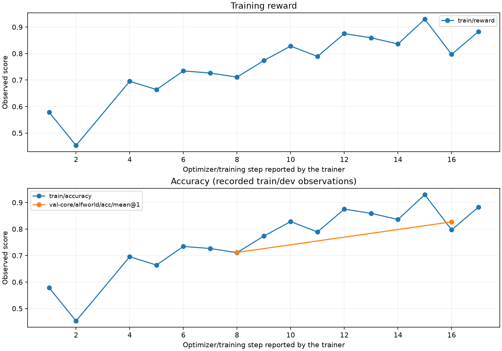

# 基于 Skill 的自进化 Agent 训练 Harness

[English](AAAA_Design_Idea.md) · 简体中文
一键启动脚本：./examples/skill_self_evolve/run.sh
## 思路

研究问题是：agent 的训练过程能否同时改进模型参数和持久化的外部文档（解决任务、提炼 skill、在后续任务上测试 skill、接纳有用的 skill），这里有几个难点：

1. 工程上，需要修改verl这类框架以支持有状态训练

2. 一个model需要同时承担写skill和用skill两个任务，如何将这两个任务联合训练

3. 如何评价一个skill的好坏，即如何设计reward


## 设计理念


### 机制设计 + reward 怎么给
对于一个可程序化验证的环境来说，一个 skill 的好坏，取决于它能否帮助后续任务取得增量收益，而不是它写得像不像经验总结、来源任务是否成功。即过去基于rubrics直接评判skill的方法，在我的经验里是没啥用的，因此这次直接放弃写rubrics，而是从结果奖励和跨步信用分配（延迟奖励）来设计训练recipe。


因此，在实验设计里，模型会分为solver（负责解决问题）和curator（负责总结提炼skill）两个角色，针对这两个角色，分别设计奖励。具体来说，训练中有两类奖励：

- **结果 reward**：solver 完成任务得 1，正常失败得 0，训练模型把任务做好。
- **延迟 reward**：评价某条 skill 对后续任务究竟有没有帮助，训练模型提炼有用经验。

结果奖励很简单，以下是对延迟reward的说明：
对同一道后续任务，固定评估模型、初始环境和其他 skill，只改变是否加载目标 skill：

\[
\Delta(B,S)=R(B,\text{加载 }S)-R(B,\text{不加载 }S)
\]

| 加载后的结果 | 不加载的结果 | 对 skill 的评价 |
|---:|---:|---|
| 1 | 0 | **有正贡献：+1** |
| 0 | 1 | **产生负作用：−1** |
| 相同 | 相同 | **当前未观察到增益：0** |

当前对 **两个不同后续任务取平均**。例如一题改善、一题不变，最终收益就是 **+0.5**。

这个设计体现了三个判断原则：

1. **成功经验未必有用。**原任务成功，但提炼出的总结可能太具体、错误泛化或没有额外信息，后续收益仍可能为零或负。
2. **看迁移，而不是复述。**评价发生在不同的后续任务上，鼓励提炼共同的操作方法和前置条件。
3. **让提炼动作承担后果。**迟到收益关联回原始 curate 动作，用于更新在线模型；正收益候选才能进入正式 skill 库。未完成评估的候选保持待定，不伪造零分。

简单来说，我们的奖励信号如下所示：
| 信号 | 当前定义 | 接收方 | 时间点 |
| --- | --- | --- | --- |
| Solver 结果 | 环境成功为 1，失败为 0 | Solver policy-gradient 分支 | Episode 评分时 |
| 延迟 skill utility | 后续 B 任务上的配对差值均值 | 原始、已保留的 curate 动作 | Credit window 成熟后 |
| Skill 成本 | 生成的 curate token 数乘以成本系数 | 从 skill utility 中扣除 | 结算时；当前系数为 0 |
| KL | 相对参考策略的正则项，系数 0.001 | 仅作用于 solver loss | 在线更新时；不属于额外任务奖励 |


### 训练策略设计
设计完reward之后，接下来会有第二个问题，即curator和solver发生在一个rollout的前后阶段，且他们给奖励的时机也不同。


这里就会牵涉到第二个问题，Solver 完成任务 A 后，可以立即获得任务结果 reward；curator 随后从 A 的轨迹中提炼 skill，但这个 skill 是否有价值，往往要等后续任务 B、C 使用它之后才能判断。因此，两类 reward 对应不同的动作，也在不同时间到达。

如果直接把两个 reward 相加，作为任务 A 的终局奖励，就会出现信用分配错误：后续复用收益应该评价“提炼这个 skill”的动作，而不应笼统奖励 A 的全部解题 token。同时，当延迟收益到达时，原始轨迹可能已被训练脚本消费掉了，在线模型也已经更新多次，生成 skill 时的策略与当前策略不再一致，不能直接沿用即时、同策略的 GRPO 更新方式。


由于之前的训练经验（DeepInnovator：https://arxiv.org/abs/2602.18920），直接让模型在两个角色下接受reward进行联合训练会非常不稳定，通常无法提升，因此，我采用类似古时候做孪生网络训练时的 teacher–student 的双分支结构：online solver 与 curator 使用相同模型结构，在线模型同时接受 solver loss 和 curate loss，即 (L=L_{\text{solver}}+\lambda L_{\text{curate}})；curator 不单独进行梯度更新，而是通过参数移动平均来复制 跟随在线模型，当前为 (\phi\leftarrow0.95\phi+0.05\theta)。这样，在线模型学习任务求解与经验提炼两种能力，curator 则以更平滑的参数变化持续产生候选 skill。

因此，我们的训练策略可以概括为：
| 角色 | 参数来源 | 梯度／optimizer | 用途 |
| --- | --- | --- | --- |
| 在线 solver，theta | 可训练的 Qwen3.5-4B | 一个 optimizer 接受 solver 和 curate loss | 解决任务，并学习哪些提炼动作有价值 |
| Curator，phi | 在线模型的 EMA | 没有独立 backward 或 optimizer | 阅读已完成的来源证据，提出 skill 或弃权 |
| KL reference | 普通 actor／ref 栈中的固定参考策略 | 不参与优化 | 对 solver 更新施加正则约束 |


初始化时 phi 等于 theta。每次在线 optimizer 更新成功并被确认后执行：

$$
\phi_{t+1}=0.95\phi_t+0.05\theta_{t+1}.
$$

这是对**模型参数**做 EMA。这种设计希望让提炼策略平滑地跟随共享在线模型的学习。


## 训练 harness 改造
延迟归因由另一套机制负责：持久保存原始 curate 上下文、动作 token 和生成时的 behavior logprob；待反事实收益成熟后，将其关联回原始提炼动作，在在线模型上重新计算 curate loss，并通过重要性权重、裁剪和 replay 滞后限制缓解 off-policy 偏差。

### 为什么默认verl做不了


### 为什么原始 rollout 基础设施还不够
TLDR：没有自动提供跨任务的 skill 状态管理与信用分配机制

verl 已支持多轮 agent、工具、自定义循环、reward 函数和分布式训练，主要缺的是是跨 episode skill 状态，以及对应的生命周期和 credit 约定：

| 缺少的部分 | 为什么重要 |
| --- | --- |
| 持久化、带版本的 skill 记忆 | 后续 episode 需要稳定地读取早期 episode 产生的 skill |
| 来源→skill→使用者的谱系 | 后续有用的结果必须能找到最初的提炼动作 |
| 超过 TQ 生命周期的 behavior 轨迹保存 | 延迟标签到达时，普通 learner row 已经被消费和清理，需要维护这状态 |
| 独立的 curate replay advantage／mask 路径 | 需要训curator |
| 在线参数／EMA 协调更新与联合恢复 | 模型、skill 库、replay 和 credit 不能各自独立重启 |


### 我们的工程修改
因此工程上，我们复用 verl 的 Ray、rollout、TransferQueue 和 FSDP 基础设施，通过扩展 rollout adapter、Task、actor loss 和 trainer hook，接入了一条持久化的 skill 学习支路。

首先，在 rollout 与输入构造层增加 SkillStore 和来源审阅队列，使后续任务能够加载已有 skill，并让 curator 审阅已完成的 solver 轨迹。Curator 生成 skill 后，将完整上下文、动作 token、训练 mask、原始 behavior logprob 和策略版本写入独立 replay，这一步主要是在传统verl记录rollout id的基础上额外记录skill。

其次，新增异步反事实评估与 credit ledger，将后续任务中“加载／不加载 skill”的结果差值，关联到最初的 curate 记录。收益成熟后，controller 构造独立的 curate minibatch，重新计算当前在线策略的概率，并将迟到收益作为外部 advantage（相当于增加一次离线训练）。Actor loss 按角色区分训练 mask：solver 保留原有 GRPO 路径，curate 分支使用重要性权重和裁剪，只更新提炼动作对应的 token。

最后，扩展 learner 与 checkpoint 协调逻辑，让同一个在线模型、同一个 optimizer 联合处理两种 loss，并在真实参数更新后推进 curator 的 EMA。两种 loss 最终仍由同一个 optimizer 协调更新，更新后的参数再通过 EMA 传给 curator。


## Benchmark选择与训练数据构造

### 采用的bench：ALFWorld

ALFWorld 文本环境提供可重复运行的家庭任务、可观察的状态转移、允许动作反馈，以及权威的成功标记。它既支持操作流程的迁移，也便于程序化验证。

| 支持的任务族 | 可共享的流程或前置条件 |
| --- | --- |
| `pick_and_place_simple` | 搜索、移动、取得物体、搬运和确认放置结果 |
| `pick_clean_then_place_in_recep` | 先取得物体，再在适当设施处清洗，最后放置 |
| `pick_heat_then_place_in_recep` | 取得物体、使用加热操作／设备，再放置 |
| `pick_cool_then_place_in_recep` | 取得物体、使用冷却操作／设备，再放置 |
| `look_at_obj_in_light` | 协调目标物体与已开启的光源 |
| `pick_two_obj_and_place` | 重复执行取得／放置流程，并跟踪两个不同实例 |

这个bench虽然比较老，但由于任务是按性质划分的，例如不同物体名称、容器和房间布局共享部分操作流程，因此很适合验证skill的创建/使用或是类似于记忆是否合理。并且模型需要与外部环境交互，比QA问题要困难许多。


### 实际的数据构造

一般来说，会采用相同的环境先找frontier model合成一波数据，但考虑到这个题目的测试属性，直接跳过了这一步。

#### 难度梯度：覆盖不同复杂度的操作流程

首先抽了400题做测试，发现模型能完成的题目有53%，因此，直接采用混合打乱采样，让训练持续接触这些复杂度层次；
训练任务覆盖基础取放、灯下观察、清洗／加热／冷却后放置，以及双物体取放等类型。它们从不同角度增加搜索、状态前置条件、操作链长度和多目标管理的要求，同时共享搜索物体、打开容器、检查持有物等子流程。

#### 任务关联：A/B任务分解

每个样本保留任务 ID、任务族和场景信息。A/B 是同一训练任务流中的不同分工：
A 是经验来源：较早完成的 solver 轨迹交给 curator，判断是否能提炼可复用 skill。

B 是后续复用任务：从后续 batch 自然出现的原始任务中，选择与 A 同族、但任务 ID 不同的实例，检验候选 skill 的效果。当前每个候选使用两个不同的 B 做配对评估。

例如，“清洗铲子并放到餐桌”与“清洗水壶并放到炉灶”虽然目标物体和场景不同，却共享寻找物体、检查容器、取得物体后清洗等流程。这样的关联使 skill 有机会迁移，而不是只复述某道题的答案。当前筛选并不强制每一对 A/B 都跨场景。

这样子的分解使得我们能够较好的利用已有数据：
同一任务族反复出现，为经验复用提供机会；不同实例的物体、位置和场景变化，则检验经验是否具有泛化性。较早的 A 产生候选 skill，后续 B 通过加载／不加载的比较评价其增量收益，正收益候选进入正式 skill 库，再被更后面的 rollout 检索使用。


## RollOut结果与实验验证


### 实验曲线


由于时间和计算资源（8 卡）的限制，训练尚未跑完整个计划。图中展示的是截至 step 17 的已记录指标：训练 batch 的 reward／accuracy 总体上升，但并非逐步单调提升；两者数值相同，是因为当前任务 reward 就是环境成功的二元结果。橙线是从原始训练数据中按场景留出的开发集（dev）准确率，不是最终官方 seen／unseen 测试成绩；step 8 和 step 16 分别为 71.18%（284/399）和 82.71%（330/399）。

不同训练 step 使用不同 batch，开发集也只有两个评估点，因此这些曲线还不能单独证明 skill 机制带来了整体泛化提升。标准指标文件缺少 step 3 的训练行，图中的连线不代表补测数据。原始指标与图像哈希已保存在 [curve_metrics.jsonl](AAAadditional_data/curve_metrics.jsonl) 和 [curve_provenance.json](AAAadditional_data/curve_provenance.json)；下面进一步通过完整轨迹分析生成、加载和奖励归因是否实际发生。

### case study


| 候选 | 来源 A／EMA | 配对差值 | Utility | 应用到的在线更新 | 普通后续加载 |
| --- | --- | --- | ---: | ---: | --- |
| 检查关闭容器后再打开查看（Disambiguate closed receptacles before open inspection） | 清洗铲子并放到餐桌；EMA1 | 清洗水壶：1-0；清洗肥皂：0-0 | +0.5 | 5 | Step6：清洗碗并放进冰箱；reward 1 |
| 在点亮的台灯下取得目标物（Retrieve object under lit desk lamp） | 台灯下观察闹钟；EMA3 | 铅笔：1-0；碗：1-0 | +1 | 6 | Step7：台灯下观察枕头；reward 1 |
| 到柜子取物并搬到马桶（Navigate to cupboard, pick item, move to toilet） | 把手巾放到马桶；EMA2 | 玻璃瓶放进柜子：0-1；手巾放进垃圾桶：1-1 | -0.5 | 5 | 未接纳 |
| 简单单物体搬运（Simple single-object transport） | 把洗碗海绵放到推车；EMA1 | 手机放到扶手椅：1-1；喷雾瓶放进垃圾桶：1-1 | 0 | 5 | 未接纳 |

表中每个来源 A 的结果 reward 都为 1，但后续 utility 不同，说明仅总结成功来源不足以构成目标函数。负例同时暴露了适用性不匹配：一条针对马桶的说明被用于另一种放置目标。它的分数衡量的是当前加载协议，不是对这个流程在任何场景下都错误的普遍判断。

### additional case study

#### 数据范围与读取方式

四组案例的原始数据已整理到 [AAAadditional_data/case_studies](AAAadditional_data/case_studies/README.txt)，总索引为 [index.json](AAAadditional_data/case_studies/index.json)。每组 `case.json` 都链接来源 A、curator 输入／输出、两个 B 的加载／不加载轨迹、utility 结算及 optimizer 消费记录。


#### Case 1：+0.5 的收益来自补齐任务条件

[完整数据：positive_half](AAAadditional_data/case_studies/cases/positive_half/case.json)

来源 A 是“清洗铲子并放到餐桌”，44 个动作后成功。轨迹中多次先移动到容器、观察其是否关闭，再执行 `open`；curator 因此提炼了“检查关闭容器后再打开查看”的 skill。

| 后续任务 | 加载 skill：reward／步数／无效动作 | 不加载：reward／步数／无效动作 | 差值 |
| --- | --- | --- | ---: |
| 清洗水壶并放到炉灶 | 1／25／3 | 0／17／2 | +1 |
| 清洗肥皂并放进柜子 | 0／19／1 | 0／11／0 | 0 |

逐步对照水壶任务可见，两侧前十步已经都执行过打开容器和取出水壶。真正与最终成功直接相关的差别发生在后段：加载侧第 13 步先放下未清洗的水壶，随后又取回，在第 23 步执行 `clean kettle 1 with sinkbasin 1`，第 25 步重新放置并成功；不加载侧没有执行任何 `clean`，轨迹在第 17 步结束，环境仍判定失败。


#### Case 2：+1 的灯下观察 skill，主要改变了动作表达与终止路径

[完整数据：positive_one](AAAadditional_data/case_studies/cases/positive_one/case.json)

来源 A 是“在台灯下观察闹钟”：第 6 步执行 `use desklamp 1`，第 8 步取起闹钟后成功。EMA3 curator 提炼了涉及光源与目标物体的操作流程。

| 后续任务 | 加载 skill：reward／步数／无效动作 | 不加载：reward／步数／无效动作 | 差值 |
| --- | --- | --- | ---: |
| 台灯下观察铅笔 | 1／5／0 | 0／50／43 | +1 |
| 台灯下观察碗 | 1／29／0 | 0／50／44 | +1 |

铅笔任务的差异尤其清楚：加载侧先到书桌、打开台灯，最后执行 `take pencil 3 from desk 1`，五步成功。不加载侧也已经打开台灯，但从第 8 步开始反复尝试 `look at pencil ...` 这类环境不支持的动作；50 步中有 43 步无效，最终失败。碗的对照同样出现大量不受支持的 `look at ...`；加载侧则在找到灯所在的位置后，用 `use` 和 `take` 完成目标。这里可见的收益更接近于**将任务描述转成有效的操作序列、摆脱无效动作循环**。

#### Case 3：−0.5 暴露了适用性与搜索预算问题，不是“搬错到马桶”

[完整数据：negative_half](AAAadditional_data/case_studies/cases/negative_half/case.json)

来源 A 成功把手巾放到马桶，但提炼出的 skill 把“柜子／台面取物→搬到马桶”写成了具体流程。后续评估仍按相同任务族选择 B，并没有充分检查目的地是否符合 `when_to_apply`。

| 后续任务 | 加载 skill：reward／步数／无效动作 | 不加载：reward／步数／无效动作 | 差值 |
| --- | --- | --- | ---: |
| 把玻璃瓶放进柜子 | 0／50／3 | 1／49／4 | −1 |
| 把手巾放进垃圾桶 | 1／5／0 | 1／5／0 | 0 |

玻璃瓶加载侧并没有真的执行“把物体搬到马桶”。它将更多动作花在微波炉、水槽、烤面包机、咖啡机、炉灶和柜子的搜索上，直到第 50 步才到达 `countertop 1`。不加载侧第 44 步就到达该台面，随后在第 46 步于餐桌发现玻璃瓶，第 47 步取物，第 49 步完成放置。手巾任务的两条动作序列则完全相同，都是五步成功。

所以，直接证据是**不适配的 skill 注入后，本次搜索顺序发生变化并耗尽动作预算**。

#### 可提升Case 4：utility 为 0，不代表没有效率收益

[完整数据：zero](AAAadditional_data/case_studies/cases/zero/case.json)

来源 A 用六步完成“把洗碗海绵放到推车”，提炼结果是简短的“找到、拿起、搬运、放置”流程。两次后续配对都成功，因此按当前二元结果奖励结算为零：

| 后续任务 | 加载 skill：reward／步数／无效动作 | 不加载：reward／步数／无效动作 | 动作数差异 |
| --- | --- | --- | ---: |
| 手机放到扶手椅 | 1／10／0 | 1／31／1 | 少 21 步 |
| 喷雾瓶放进垃圾桶 | 1／16／0 | 1／20／0 | 少 4 步 |

手机任务中，不加载侧依次搜索了更多抽屉，到第 28 步才去书桌取手机；加载侧在检查两个抽屉后就去书桌，十步完成。喷雾瓶任务也减少了无收益的搜索动作。虽然这两对都观察到了动作数节省，但其结果差值均为 `1 - 1 = 0`，所以 utility 为 0，候选未入主库。

这个案例揭示了当前 reward 的取舍：**它主要评价成功率增量，不评价在同样成功前提下的效率改善。**。


## 附录与其他细节
### curate reward与loss计算
#### 什么时候给
1. Solver episode A 结束，保留其原始任务结果 reward。
2. EMA curator 接收该 episode 的已观察轨迹，生成 skill 动作。
3. 在 TQ 清理之前，将完整 curator 输入、原始生成 token ID、curate mask、processed behavior logprob、策略版本及 skill 引用持久写入 `CurateReplayRecord`。
4. Learner 在当前在线参数下重新计算**旧 curator 上下文／动作**，将 U(S) 作为外部 advantage 更新在线模型；

延迟奖励属于提炼动作，不会覆盖 A 的任务 reward，也不会广播到 A 的所有 solver 动作上。Curator 副本通过后续参数 EMA 间接吸收更新。


### Skill 提炼与加载

#### 什么在进化

在线参数和持久化 skill 库共同演化，curator 通过 EMA 跟随在线参数。在声明的实验协议下，benchmark 任务池和冻结评估器保持固定。

候选 skill 由模型输出五个字段：

```json
{
  "skill_id": "host-assigned-identity",
  "title": "A concise procedural title",
  "principle": "A reusable procedure with observed prerequisites and checks",
  "when_to_apply": "The relevant goal and state conditions",
  "task_families": ["pick_and_place_simple"]
}
```


另一种合法动作是弃权：

```json
{"decision":"abstain","reason":"The observed evidence does not support a reusable procedure."}
```

#### SkillStore

当前检索器采用确定性的“任务族＋词汇匹配”。以 `top_k=6` 预算选择完整 skill，随后检查完整渲染 prompt 的预算。宿主把选中内容注入 Task 的 user message；当前版本不训练模型自主决定是否调用检索工具。

目前尚未实现语义去重、自动 skill 改写、skill搜索。


## 局限与后续实验


### 想做还没做的

所有的实验在2天x8张H800上完成，由于时间比较紧张，以下是应该要做但还没做的：

1. 各类消融实验，尤其是EMA、off-policy的潜在偏差
2. skill文本长度的控制，目前虽然实现了但一直设为0
3. 完成任务的效率实验，如果说一个skill能让一个任务完成的step变少，那也应该给奖励，这个还没加上
4. Skill的抽象性控制，如何在背诵答案和泛泛而谈之间取舍
5. 检查实现细节，由于时间比较紧张，大部分训练代码是codex w/ gpt-6.1完成的，我确认了agent训练的代码，但环境准备、数据接入的代码没有时间确认
6. Harbor统一格式的接入
7. 对于“在技能库里搜到一个好技能”的强化，目前任务其实影响不明显。但缺少语义去重、效用排序和淘汰。库变大后，可能出现重复技能挤占上下文、好技能检索不到的问题。


### 当前设计的问题
1. **动作接口。** 当前通用 shell 允许出现偏离任务的工具循环。Step 5 中，128 条 episode 的 126 条在约 8 分 40 秒内完成，但两条零游戏动作的 episode 都耗尽了 900 秒，将 rollout 延长到 20 分 35 秒。一条反复轮询无关安装进程，另一条不断生成错误工具调用。
2. **Skill 抽象与验证。** 生成文本可能过拟合物体名称、编造环境机制，或重复泛泛指令。后续应加入结构化前置条件、证据引用、内容级去重和适用性检查，并保留负向证据，而不是把每个候选都展示成有用技能。
3. **Off-policy 偏差。** 历史动作比值、权重上限和 replay 滞后限制不能修正整个系统的变化。应比较不同上限、滞后窗口、评估器刷新策略和 on-policy 替代方案，且不能悄悄改变归因结论。
4. **Reward 稀疏性。** 两侧都失败或都成功时，二元配对差值都可能为零。且任务太简单了。


### Scale Up 瓶颈
1. 由于EMA的存在，一个模型需要在卡上复制两份以维持异步训练，这对显存来说会有显著开销
2. 反事实评估成本增长快，每个 skill 默认需要两个任务、各跑“有／无 skill”两支，即 4 个额外 episode。
3. 跨步信用分配需要维护一个在GPU上的数据队列，但不参与即时计算，可能在2-3个step之后才会被使用。这部分infra还需要提升。


## 相关实现

- [verl](https://github.com/verl-project/verl)：本项目复用其分布式 RL 基础设施和扩展点。
- [SkillRL](https://github.com/aiming-lab/SkillRL)：一个参考项目。
- [ALFWorld](https://github.com/alfworld/alfworld)：本项目使用的原始家庭任务 benchmark。